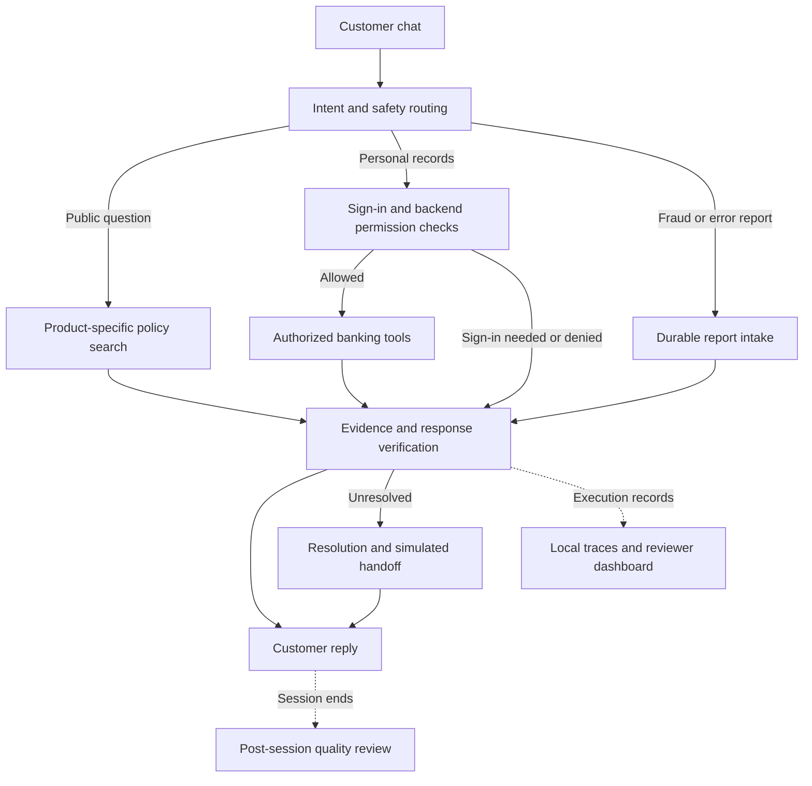

# ResolveGuard AI

**Clear banking answers. Protected account information. Verified next steps.**

ResolveGuard AI is a banking support assistant that helps customers find account terms, ask about payments, report unfamiliar charges, and understand support-case status. It addresses a common problem: a chatbot can sound helpful while choosing the wrong policy, exposing private information, or claiming a request succeeded without evidence.

Customers can ask public questions as guests. Personal records require sign-in and backend permission checks. The prototype combines policy search, defined workflows, synthetic banking tools, and response verification. Its evaluation process examines the complete interaction, including what was saved, accessed, and communicated—not just whether the answer sounds convincing.

Everything runs against **Bank of Whatever**, a fictional bank. No real customer accounts, financial transactions, or bank integrations are involved.

## Why it matters

| Customer problem | ResolveGuard's approach | Customer benefit |
| --- | --- | --- |
| “What is my account's monthly fee?” | Clarify the product and retrieve applicable terms | An answer for the right account tier |
| “Why was I charged?” | Request sign-in, then check permission before reading records | Private information stays protected |
| “I don't recognize this payment.” | Preserve the report and verify its recorded state | Clear confirmation of what was actually saved |
| “Did support receive my request?” | Distinguish confirmed, pending, and unknown outcomes | No invented success or callback promise |

## Key capabilities

- **Guest-first support:** public product, fee, waiver, and savings-rate questions without sign-in.
- **Controlled account access:** backend checks for ownership, delegated authority, and cross-account restrictions.
- **Reliable reporting:** durable fraud/error intake and duplicate-safe synthetic case workflows.
- **Verified replies:** facts and action claims checked before sending; unresolved issues get evidence-based next steps.
- **Evaluation-first development:** repeatable scenarios, failure analysis, human feedback, and traceable execution.

These capabilities are implemented and tested in a synthetic environment. Live-model quality, source approvals, and production controls are not fully qualified.

## How it works

LangGraph coordinates defined account workflows. Optional model calls provide constrained conversational framing; trusted Python services enforce permissions, preserve factual passages, and verify outcomes. Public policy search stays separate from private records. [Architecture details](docs/ARCHITECTURE.md)

## Evaluation: what the evidence shows

The process is **define expected behavior → run a baseline → inspect failures → make a focused change → retest the same cases → check regressions → review with people**. Full-journey checks matter because correct intent alone does not prove correct reporting, access, or action confirmation.

### Historical mock-rule improvement

| Metric | Baseline | Improved |
| --- | ---: | ---: |
| Intent accuracy | 85% | 100% |
| Full-journey pass | 80% | 97.5% |
| Fraud/error recall | 80% | 100% |

Same **40 development cases**, three repeats per version. Seven unique cases improved, none regressed, and one remained failed. These are **mock-routing rule results**, not independent live-model accuracy. [Saved comparison](artifacts/mock_iterations_final/comparison.json)

**Example failure:** RG-020 said, “My card was used at a gas station while I was at home; that was not me.” Initial rules missed the fraud signal. Adding indirect unauthorized-use phrases corrected routing and report preservation in the saved improved runs. [Failure-to-fix evidence](docs/EVALUATION_RESULTS.md#rg-020-failure-to-fix)

### Separate evidence streams

RAGAS checks whether answers are supported by retrieved policy evidence. An LLM-as-a-Judge is a model grading selected response qualities against a defined rubric.

| Evidence | Recorded result | Important boundary |
| --- | --- | --- |
| Automated regression | 326 main tests passed, one skipped; 13 fixture tests passed | Local synthetic verification |
| Original100 / BOW100 | 100/100 local case checks each; BOW trace linkage 100/100 | **16 source-contract conflicts remain unresolved** |
| RAGAS grounding evaluation | 12 public-policy cases; mean faithfulness 0.9167 | Two low individual scores retained for review |
| LLM-as-a-Judge | Public sample: 12/12 PASS; curated examples: six PASS, six FAIL | Executed grading; not calibrated human agreement |
| Human review | Chat: 14 PASS / 6 FAIL / 2 PARTIAL; Excel: 23 PASS / 2 FAIL / 3 PARTIAL | Overlapping live-app observations, not 50 independent tests |

Both human reviews were received and recorded. Human–judge agreement is not calculated because the human reviewed live replies while the judge graded different saved replies. Live Nebius calls were made; a verified total provider cost is not reported.

[Detailed results and rubric](docs/EVALUATION_RESULTS.md) · [Evaluation workbook](ResolveGuard_AI_Final_Evaluation_Submission.xlsx) · [Judge report](artifacts/remediation_20261101/report/LLM_Judge_Analysis.xlsx) · [Human review receipt](submission/human_review_reconciliation/REVIEW_STATUS.json)

## Technology

| Technology | Responsibility |
| --- | --- |
| Python 3.12, Pydantic | Backend logic and typed data validation |
| FastAPI, HTML/CSS/JavaScript | Local API and customer interface |
| LangGraph, SQLite | Defined workflows, saved state, reports, and retries |
| Local policy retrieval | Bank/product/date/access filters and keyword ranking |
| Nebius GLM-5.3-Flash | Optional constrained reply framing and separate judging |
| RAGAS, Qwen3-Embedding-8B | Semantic evaluation; embeddings are not deployed app retrieval |
| Local traces and dashboards | Tool outcomes, latency, errors, and reviewer inspection |

Bank of Whatever includes 11 products, 19 policies, 61 retrieval chunks, 12 customers, 12 accounts, 48 transactions, and 100 banking scenarios, plus session, case, and delegation fixtures.

## Limits and next steps

- Resolve the **16 contradictory source-tool expectations** and formal reference/provenance decisions.
- Retest the remaining product-context failures and refusal-wording partial passes; review the two grounding disagreements.
- Obtain labels for identical saved responses before claiming human–judge agreement. No second-judge comparison has been performed.
- Broaden independent holdout and live-response evaluation; development cases do not establish general accuracy.
- LangSmith Cloud verification, Replit deployment, and real banking integrations remain deferred. Local traces and GitHub CI do not prove hosted LangSmith execution.

This is an **adapted banking portfolio project** using the Gen Academy inspect–categorize–improve–retest method. Its mock-rule work and banking response judge do not substitute for every requirement of the supplied e-commerce exercise.

No money movement, real refunds, official bank cases, or production compliance certification is provided. License selection remains open.

## Explore the evidence

[Architecture](docs/ARCHITECTURE.md) · [Security boundaries](docs/SECURITY.md) · [Historical UI screenshot](demo/screenshots/welcome_historical.png)

Public report copies have privacy redactions. Original-source hashes refer to privately retained originals; see [public-copy provenance](https://github.com/akanshk-cmyk/ResolveGuard-AI/blob/main/PUBLIC_RELEASE_NOTES.md).
