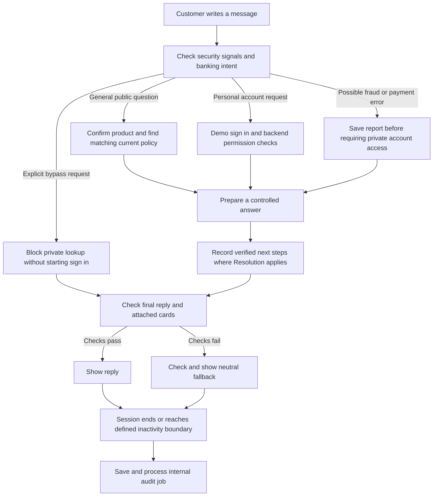

# ResolveGuard implementation alignment and next steps

Reviewed October 31, 2026. Scope: the local learning/demo application, its original
PRD v0.4 and Observability BRD, subsequent customer-chat/admin specifications,
implementation code and recorded evaluation results.

ResolveGuard largely follows the agreed demo direction: customers can ask public
questions, identify the right product, securely enter a simulated account journey,
report a problem and receive a verified receipt. It is **partly aligned with the
full design**, not feature complete or ready for real banking customers. The main
remaining work is answer verification, complete evaluation coverage, useful
reviewer workflows and authoritative operational integrations.

No customer-facing code, banking data, credentials or running configuration was
changed during this review. The original product PDFs and workbook are preserved.

## How the conclusion was reached

An item counts as working when implementation and relevant test evidence exist.
An item is partial when only part of its promised behavior works. A specification,
schema, installed library or configured key alone does not establish a working
integration. A small pilot does not establish broad quality or production safety.

The original PRD favors one customer-facing assistant with controlled specialist
services. That matches the current direction. Resolution and QA are mostly Python
rules and evidence checks; they are not three independently reasoning AI models.
The original PRD preserves older 60-case material and appends the v0.4 controls
for 100 original RG cases. The additional 100 BOW cases are a separate dataset.
Neither 100-case requirement is satisfied by running the selected 40 cases.

## The current customer journey

Public questions use a direct web-service path; account conversations use
LangGraph, the framework that controls the order of workflow steps. Both pass
through the shared response checker. The diagram describes responsibilities,
not a claim that every box is a separate LangGraph agent or AI call.

## What is implemented and what remains

| Capability | Status in the demo | What remains |
| --- | --- | --- |
| Guest-first chat | Working | A real bank sign-in service is separate work. |
| Product clarification and follow-up | Working for supported questions | Broader ambiguous, mixed-topic and long conversation coverage. |
| Policy retrieval, often called RAG | Working locally | It searches supplied evidence by words and metadata. Vector search and Pinecone are not connected and are not required to finish this small demo. |
| BOW product and policy data | Working | 11 products, 19 policies and 61 linked chunks are synthetic. Bank approval and real published offers are not supplied. |
| Product comparison | Working for supported evidence | BOW lacks a payment-status glossary; pending-versus-posted definitions must remain unavailable until an approved source is added. |
| Account and case permissions | Working against synthetic backend records | Real identity, banking APIs, signed service identity and institution-controlled permissions. |
| Fraud/error intake | Working in tested journeys | Real fraud/disputes operations, approved urgent contact channels and institution-defined notice handling. |
| Support-case creation and duplicate prevention | Working | Real case-system connection and broader concurrent/failure testing. |
| Human handoff | Simulated, with receipt checks | A real receiving team, availability, accountable owner and approved alternate channel. |
| Security-aware routing | Working for tested attacks | Broader paraphrase, multilingual, encoded and multi-turn attacks. Backend permissions remain the independent safeguard. |
| Resolution | Partly working | Records some verified next steps. General unresolved-issue detection, assigned priority and confirmed callback windows are incomplete. |
| Check before each reply | Active but partial | Verifies specific access, source, card and receipt rules; does not establish that every sentence agrees with its evidence. |
| Review after the session | Active but partial | Aggregates recorded checks. Independent conversation assessment, useful prioritization and reviewer completion are missing. |
| Pydantic and LangGraph | Working | Pydantic checks data shape; LangGraph controls steps. Neither proves that an answer is true. One-process deployment remains the supported demo setup. |
| Live customer-facing GLM answers | Not enabled | The web app uses mock routing and controlled templates. Optional Nebius routing and evaluation are separate. |
| RAGAS and LLM judge | Implemented and piloted | Three public-policy cases have actual provider results. Broader banking, comparison, fraud and permission coverage plus human calibration remain. |
| LangSmith Cloud | Prepared, unverified | No configured LangSmith key was found at review time; hosted dataset/experiment/trace verification remains pending. |
| Local operations dashboard | Working with limits | Shows batch history and optional workflow metrics. It is not the complete Agent Review Admin workspace. |
| Live monitoring coverage | Partial | No local monitor database was configured at review time. Public routes, security events and new review tables are not one complete operational view. |
| Replit hosting | Configuration only | No verified hosted deployment. |
| Real balances, money movement, refunds and card blocking | Not available | Balances lack an authoritative API. Financial actions, credit-card servicing and voice remain outside the agreed MVP. |

## Important findings

### Answer verification needs strengthening before live generated replies

An isolated check changed a BOW fee answer to an incorrect fictional $999 fee
while keeping its original valid policy sources. The current gate returned
`APPROVE`, including `GROUNDING=PASS`. The test used temporary storage and did
not change a customer session.

This establishes a specific gap: checking that a source is genuine does not
check that the answer correctly uses it. The current controlled templates reduce
the immediate exposure, but the gate must not be relied on as a complete defense
for a future freely generated answer. Similar independent checks are needed for
unsupported amounts, waiver conditions, product mix-ups and promises of action.

Recommended completion test: a changed fee, rate, condition, case state or promise
is rejected even when valid sources are attached. A failed source/receipt check
must continue to fail closed. Use deterministic checks for exact financial facts;
add calibrated semantic assessment where rules alone are insufficient.

### The review queue currently marks every audited session for review

The local snapshot contained 22 completed audit jobs, all with `NEEDS_REVIEW`.
The code intentionally marks online intent accuracy `NOT_EVALUABLE`, since no
independent reference label exists, and then treats any non-pass finding as a
reason for post-session review. The jobs completed technically; this does not
mean a human reviewed them or a customer problem was resolved.

Recommended completion test: a session with no detected safety issue, an
unmeasured quality dimension and a confirmed safety failure remain distinct.
Unknown quality must stay visible without making every session equally urgent.
Create ownership, review status and completion actions without downgrading
critical failures.

### Resolution records next steps but cannot promise operational outcomes

The service records a verified report/case/handoff reference when its implemented
paths apply. It has no authoritative priority assignment or callback service.
Its unresolved triggers are limited; it is not a comprehensive assessment of
every unfinished conversation. A normal saved-case confirmation is not, by
itself, a full case-resolution decision.

Recommended completion test: every agreed unresolved journey records an owner,
supported next action and either a verified callback commitment or an explicit
unconfirmed state. Do not introduce arbitrary promised response times.

### Review evidence is spread across separate stores

Banking events, conversation checkpoints, public turns, workflow traces, security
events and QA reports exist, but the operations dashboard does not join them into
one customer-session history. Security event records do not currently expose a
shared session/turn reference for straightforward reviewer navigation.

Recommended completion test: an authorized reviewer can follow one session from
the customer request through product choice, access decision, policy evidence,
tool result, delivered reply and review outcome. Playback must not repeat banking
actions. Exact displayed response retention needs its own privacy controls.

### Full qualification remains blocked

The latest versioned 40-case run passed 39 cases. Its remaining failure is the
previously known policy-evidence failure, RG-056. Both intent accuracy and
fraud/error recall were 100% within this mock development set. These percentages
do not establish live model quality.

The original RG-001 through RG-100 release suite has not been fully executed by
this runner. The separate 100 imported BOW cases remain `NOT_RUN`. Human review,
prompt provenance and independent judge calibration are still pending.

The security change preserved the original 40-case file. A versioned copy changes
only RG-054's superseded routing/state expectation to the newly requested attack
block, with additional flag and no-restricted-call assertions. Its labels still
require human review. Results before and after that label change must not be
presented as a pure improvement in model quality.

## Alignment with the requirements

| Requirement group | Assessment | Reason |
| --- | --- | --- |
| PRD FR-01/02/16/17/22: identity and permissions | Partial | Synthetic identity, session, delegation and service boundaries exist; production identity and signed banking context do not. |
| PRD FR-03: grounded explanations | Partial | Retrieval and scoped presentation work, but the online gate does not verify every answer claim. |
| PRD FR-04/05/12/15: case state, creation and recovery | Substantial demo coverage | Durable writes, confirmation and reconciliation exist; full-suite and real-service verification remain. |
| PRD FR-06/18: fraud/error preservation | Substantial demo coverage | Original statements and separate states are preserved in tested synthetic paths; institution-approved operational semantics remain open. |
| PRD FR-07/19/21: urgent routing and handoff | Partial | Simulated receipt/backup routing works; actual teams, contact channels and service commitments are absent. |
| PRD FR-08/11: excluded actions and typed safety routing | Substantial demo coverage | Prohibited financial tools are absent, and independent security signals were added; detector coverage is bounded. |
| PRD FR-09/20: privacy | Partial | Field limits and minimized exports exist; masking approval, secret handling, retention and protected archives remain. |
| PRD FR-10/13/14/23: audit and release evidence | Partial | Local traces and scoring exist; full risk-suite execution, human approvals and complete reviewer reconstruction remain open. |
| BRD T1/T2: session traceability and protected review | Partial | Per-run evidence exists; joined session playback, staff access scopes and approved retention do not. |
| BRD E1/E2/E3/E4: calibrated evaluation and critical gates | Partial | Binary checks and judge scores exist, but broad human-reviewed exemplars, holdouts and full critical coverage are missing. |
| Agent Review Admin US-01 through US-04 | Mostly pending | A lightweight operations view exists; staff roles, session search, review notes, protected exports and configurable alert delivery are not complete. |

The BRD asks for evidence-based yes/no questions and human calibration. The current
judge provides pass/fail and 1–5 opinions, but those scores alone do not satisfy
that calibration requirement. Local application inserts also do not establish a
tamper-proof compliance archive.

## Recommended implementation order

| Order | Next work | Why it comes next | Completion evidence |
| --- | --- | --- | --- |
| 1 | Strengthen answer verification and fix RG-056 retrieval | Close known truthfulness gaps before adding free-form model replies. | Wrong facts with valid citations are blocked; the unchanged failure reproduces and then passes with the right policy. |
| 2 | Make post-session review useful | Prevent an undifferentiated queue from hiding real problems. | Normal, unknown-quality and critical-failure sessions are distinguishable; review ownership and completion are recorded. |
| 3 | Agree and human-review the evaluation baseline | Ensure the tests describe intended behavior. | Keep original RG and BOW suites separate; approve label revisions and expected outcomes with provenance. |
| 4 | Execute the original 100 risk cases and the 100 BOW cases | Measure actual coverage instead of equating imports with tests. | Every case has a result or explicit block; all designated critical assertions pass. Add adversarial and multi-turn regression coverage. |
| 5 | Join evidence and add the read-only reviewer workspace | Make failures explainable and actionable. | Staff-scoped search, one-session timeline, source/tool evidence, notes and safe playback. Connect optional aggregate monitoring across public and private routes. |
| 6 | Broaden semantic evaluation and verify LangSmith | Measure answer quality and hosted trace delivery separately. | Human-reviewed references, calibrated judge agreement, verified cloud read-back and documented minimal outbound fields. Cloud verification needs the key. |
| 7 | Add authoritative priority, callback and approved contact services | Give supported commitments rather than invented wait times. | Backend-assigned priority, accountable queue and verified callback/fallback events. |
| 8 | Consider live chat model and hosted deployment | Increase complexity only after the checks and evidence work. | Controlled pilot, cost/latency results, failure fallback, rollback and explicit data/privacy decisions. |

Orders 1 and 2 can be completed locally without cloud credentials. Several later
steps can progress in parallel once their own prerequisites are satisfied. Adding
vector search, voice, long-term agent memory or more independent AI agents is not
necessary for these next steps.

## Product decisions still needed

Agree the demo acceptance scope and the authoritative test-suite versions. Assign
who approves sample policies and evaluation answers, who owns urgent incidents,
and which queues/contact channels the app may display. Define retention for
original reports versus minimized review evidence. Before real customers, select
the actual identity/case/banking services and approve privacy, service targets,
incident response and rollout gates. Do not invent business success baselines.

For the learning demo, missing real banking services should stay explicitly
simulated. For production, they become prerequisites; they are not small UI tasks.

## Verification and evidence

- Fresh review-time test execution: 250 main tests run, 249 passed and one skipped;
  13 fixture tests passed. Combined: **262 passed, one skipped**.
- Latest saved browser check: **46 passed**, no recorded browser exceptions. It is
  a smoke check, not a full accessibility or usability assessment.
- Security journey report: **8 of 8 passed** in
  [security results](../artifacts/security_evaluation/results.json).
- Versioned mock banking run: **39 of 40 passed**, release decision `BLOCKED`, in
  [regression summary](../artifacts/security_routing_regression_v2_001/summary.json).
- Completed three-case public semantic pilot: all three judge grades passed;
  retrieval recall, precision and faithfulness were approximately 1.0 in this small
  sample. See [pilot summary](../artifacts/semantic_pilot_20261031/post_fix_summary.json).
  Answers and evidence changed together, and this pilot predates later security/QA
  changes. It is not fresh qualification of the current whole application.
- Review-time local configuration: Nebius key present; LangSmith key and optional
  monitoring database absent; cloud tracing flags off. Keys were not displayed
  and no provider request was made for this review.
- App and operations landing pages responded locally on ports 8765 and 8766.
  A reachable landing page does not establish complete operational coverage.
- Review snapshot: 98 local reply-review records, 22 completed audit jobs, and
  22 `NEEDS_REVIEW` post-session decisions. Counts change with use and are not
  customer-resolution metrics.

Source requirements: [PRD v0.4](../ResolveGuard_AI_Final_PRD_v0.4_Risk_Remediated.pdf),
[Observability BRD](../ResolveGuard_AI_BRD_Agent_Observability_v1.0.pdf),
[customer UX specification](CUSTOMER_CHAT_UI_SPEC.md),
[Agent Review Admin specification](AGENT_REVIEW_ADMIN_SPEC.md),
[Resolution and QA](RESOLUTION_AND_QA_WORKFLOW.md), and
[security routing](ADVERSARIAL_ROUTING.md).

Implementation evidence: `web.py`, `workflow.py`, `conversation.py`, `backend.py`,
`bow_backend.py`, `bow_knowledge.py`, `customer_review.py`, `review_flow.py`,
`security_routing.py`, `security_evaluation.py`, `evaluation.py`, `dashboard.py`,
`monitoring.py`, `semantic_evaluation.py`, `ragas_eval.py`, `judges.py`,
`cloud_verify.py`, and `pyproject.toml` under the project root/package as applicable.
