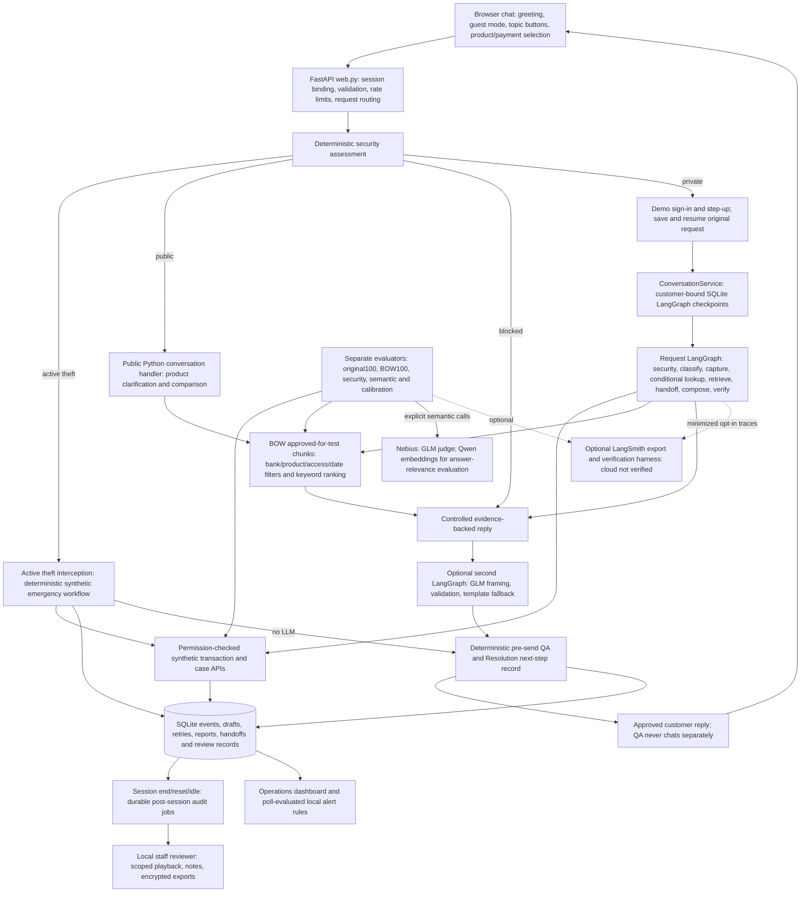

# ResolveGuard AI — implementation, architecture and evaluation audit

Audit date: November 1, 2026 (America/Los_Angeles). Scope: repository at `.`.

## Decision

**Mandatory work is not all complete. The project is a substantial synthetic prototype, not a qualified banking system or a completed evaluation submission.** Backend permissions, durable intake, idempotency, controlled case submission, local review, bounded live reply framing, semantic evaluators and dashboards exist. Current end-to-end defects, incomplete human qualification, incomplete trace linkage and governance approvals prevent a completion claim.

No application, test, prompt, dependency or configuration code was changed during this audit. Only audit documents and new evaluation artifacts were written. Existing reports were retained. Fresh accepted checks used process-local reply mode `off` and both cloud tracing switches `false`; these settings did not change `.env` or the running app. An initial unit-test launch inherited live reply configuration, was interrupted and is excluded from accepted evidence; provider activity from that interrupted launch was not independently reconciled. No cloud publishing, deployment or real bank action was performed.

The supplied PRD is headed **proposed for stakeholder review / not launch approval**, and the BRD is a stakeholder-review draft. Repository evidence does not establish that either is formally approved. They are treated here as the requested target baseline, not proof of institutional sign-off. The user previously deferred LangSmith Cloud, Replit deployment and real bank integrations; those remain intentional exclusions from local completion, while still missing for requirements that explicitly demand them. The current audit prompt ends midway through Part 6; later acceptance conditions were not supplied.

## Evidence and fresh verification

| Evidence | Actual finding | Limits |
| --- | --- | --- |
| Main unit/integration suite, fresh | 309 run: 308 passed, 1 skipped, 71.088 seconds | Reply generation disabled in this accepted run; no broad live-model qualification |
| Synthetic fixture suite, fresh | 13/13 passed | Synthetic API scope, not real IAM |
| Original 100-case runner, fresh | 99/100 passed; 83/84 critical case runs passed; intent and fraud recall 100% under implemented assertions | RG-087 fails; all 100 references remain human-review pending |
| BOW 100-case runner, fresh | 100/100 local assertion passes; 16 contradictory source tool contracts; qualification BLOCKED | Structured selectors supplied by harness; not full natural-language UX or semantic correctness |
| Adversarial suite, fresh | 8/8 passed | Bounded attack cases, not comprehensive penetration testing |
| Targeted API checks, fresh | Stale own-transaction substitution, account-only non-denial, unfocused charge inquiry and transfer response reproduced | Seven controlled synthetic observations; complete outputs retained |
| BOW trace file, fresh | 78 trace objects for 100 results; result rows lack explicit trace ID links | Missing linkage prevents claiming one reconstructable trace per case |
| Original trace file, fresh | 102 trace objects for 100 cases, including repeated attempts | Extra attempts are not extra unique cases |
| Saved semantic run | 12 actual RAGAS results and 12 judge grades | Public deterministic answers, not current all-feature live reply evaluation |
| Saved calibration run | 12 actual GLM judge grades | No independently approved human labels for those exact examples |
| Human feedback | 22 cumulative observations: 14 PASS, 2 PARTIAL PASS, 6 FAIL | Not the historical 40 cases or CAL examples; run/version IDs unavailable |
| Read-only local review DB snapshot | 0 dataset label reviews, 0 review notes; 339 customer reviews, 84 audit jobs | Activity counts are not successful resolutions or audit-job completion counts |

Fresh files: `original100/{summary.json,results.json,traces.jsonl,proposed_bindings.json}`, `bow100/{summary.json,results.json,traces.jsonl}`, `security.json`, `targeted_observations.json` in this audit directory. Summary `p95_local_mock_latency_ms`: original 102.680 ms; BOW 372.084 ms. Both are local synthetic measurements with reply generation disabled, not customer-facing live-model p95 or production service objectives.

The original runner's summary says `PROVIDER_EVALUATION_DRAFT_LABELS`. This is **incorrect for this run**: 99 results have `execution_mode=MOCK`, one has `SYNTHETIC_EMERGENCY`, and no provider model was selected by this runner. `evaluation.summarize` treats any non-MOCK mode as provider execution. Preserve the original artifact and correct reporting in a later code change; do not infer real LLM quality from it.

Current Python-code fingerprint recorded by both full runners: `6341215c1822d7c726fc461161b2300976290439e0883c1e67807f33078340b9`. Historical release-check fingerprint differs (`c215be3f...`); its older 100/100 result does not qualify current code.

## Actual architecture

Interpretation: there is one customer-facing assistant, not a set of independent conversational agents. Most specialist roles are deterministic Python services. `workflow.Workflow.build_graph` creates eight nodes with a conditional restricted-lookup edge; `conversation.ConversationService.send` wraps turns with durable SQLite checkpoints. `reply_generation.ReplyGenerator.run` constructs a separate generation/validation/fallback graph. Public BOW conversations, emergency interception and customer QA are not all nodes inside the main request graph.

### Actual versus target

| Target | Actual | Architectural gap |
| --- | --- | --- |
| Identity/authority gateway before restricted resources | Demo profile sessions and FixtureBank permissions | No real identity provider or signed acting-principal context; typed account target can be ignored |
| Approved, scoped RAG | BOW immutable snapshot, hashes, filters and keyword ranking | Test-only approval; imported chunks, no institutional refresh approval or hosted vector index |
| One consistent observable workflow | Several direct web branches plus two graphs | Some branches lack full spans and consistent case-level correlation |
| Resolution then pre-response QA, plus post-session audit | Active deterministic QA/Resolution records and durable background audit queue | No independent semantic customer-journey checker or real operational ownership |
| Evidence-based action confirmation | Durable synthetic commit and relookup checks | Real banking receipts, queues and legal semantics are excluded |
| Natural dynamic replies | GLM chooses allowlisted openings/closing and immutable passage references | Cannot change or repair factual body; no arbitrary prose generation or raw streaming |
| Verified monitoring and release gates | Local metrics, alert rules and blocked reports | Incomplete trace coverage, no enforced CI/pilot deployment gate or signed decision |

### RAG and data processing

`bow_data.load_dataset` validates source counts, schemas, relationships and content hashes. The active BOW source contains 11 products, 19 policies, 61 chunks, 12 customers, 12 accounts, 48 transactions, 12 sessions, 12 cases, 2 delegations, 1 intake fixture and 100 evaluation scenarios. Archives remain separate.

BOW uses the workbook's **existing source-linked chunks**, not automatic rechunking on each request. `BowKnowledge.retrieve` requires BOW identity, known product, PUBLIC scope, explicit test allowance, matching test-only approval, eligible dates and product applicability. It ranks exact-product matches plus query word overlap. `BowPolicyIndex` adapts those chunks to the main graph. Private customer/transaction tables are queried through authorized backend tools, not embedded as public policy context.

The legacy `retrieval.chunk_document` uses a roughly 400-whitespace-token target and 50-word overlap, preserves lists/tables/exception blocks, flags oversize units and splits ordinary long prose on sentences. This is not a billing tokenizer. There is **no Pinecone, deployed vector store, hybrid reranker or production embedding search in customer RAG**. Qwen3-Embedding-8B is used by RAGAS answer relevance; it does not generate customer answers. GLM-5.3-Flash supplies optional reply framing and evaluation judgments.

## Priority findings

| ID | Finding and reproduced evidence | Risk/priority | Required next check/change |
| --- | --- | --- | --- |
| A01 | Typing ACC-003 while selected own payment BOW-TXN-001-01 returns that own Coffee Shop payment, NO_ACTION | P0 privacy-sensitive request binding; no foreign disclosure observed | Bind explicit requested account before lookup, reject conflict with stale selection, recheck actual session authority |
| A02 | ACC-005 typed without selectors returns generic payment clarification, not an ownership decision | P1; authorization expectation needs real principal precondition | Resolve resource and prove deny/allow against actual session; do not label an identifier adversarial by itself |
| A03 | Original RG-087 now returns EMERGENCY_FRAUD, forced human flag and a pending-payment candidate outside original selection; fails human_flag, response_state, no_unexpected_record | P0 qualification block; behavior/contract drift, not proven unauthorized disclosure | Review emergency contract and candidate-display scope; update expectations only with justified approval, then rerun unchanged versioned suites |
| A04 | Mixed MOCK/SYNTHETIC_EMERGENCY summary mislabeled as provider evaluation | P1 evidence integrity | Define execution modes explicitly and separate no-provider versus provider measures |
| A05 | BOW harness injects account_id and transaction_ids for cross-account tests; normal chat does not reliably derive those from text | P0 test coverage gap | Add message-only and stale-selection end-to-end tests, not only structured API selectors |
| A06 | BOW result rows lack trace IDs; only 78 trace objects saved for 100 rows | P1 observability | Trace every branch and save explicit result-to-attempt/trace/span links |
| A07 | Fresh APY question clarifies correctly; reward follow-up after YOLO reuses YOLO; product context remains confirmed | P1 clarification scope | Define topic-switch/product carry-over UX; test fresh, follow-up, ambiguous and reset states independently |
| A08 | 'transfer the fund to my account' gives generic SAFE_GUIDANCE, although no transfer tool exists | P1 unsupported-action communication | Tailored explicit transfer limitation; no sign-in promise that enables unsupported action |
| A09 | '18 dollars last month' returns generic selection; phrase/amount/date parsing limited | P1 customer journey | Recognize charge wording, currency text and relative date; search only permitted records and handle no/multiple matches |
| A10 | Guest report captures without a useful payment-linking next step | P1 human FAIL retained | Preserve first, then minimal merchant/date follow-up or secure payment selection; never make secrets/auth a prerequisite to intake |
| A11 | 16 BOW source rows require and forbid the same tool; some fixture/product labels disagree | P1 qualification block | Version coherent pre/post-auth expectations and approve fixture mapping; never silently discard contradictions |
| A12 | Human calibration pairs absent; 22 BOW observations not linked to CAL cases or historical40 | P1 evaluation qualification | Independently label exact evaluated outputs with case/version/evidence and calculate agreement/false passes/failures |
| A13 | Alerts evaluate when endpoint is polled, not at event ingestion; limited last-N rules; latency rule uses QA review duration | P2 operations | Ingestion-driven worker, real time windows and explicit end-to-end latency metric; add delivery receipts if destinations approved |
| A14 | Masking, append-only SQLite and encryption of exports exist, but do not establish bank-grade retention/immutable archival or universal PII removal | Production blocker | Institutional controls/approvals, legal hold/deletion and independent archive protection |

## Mandatory PRD requirement matrix

Statuses refer to the **synthetic agreed scope**. An implemented demo is not a real-bank integration. P0 means blocks security-sensitive qualification; P1 means required completion/quality evidence; P2 means operational hardening. No requirement is marked fully verified solely on documentation.

| Requirement ID | Expected functionality | Actual implementation | File/function evidence | Test evidence | Status | Gap | Priority |
| --- | --- | --- | --- | --- | --- | --- | --- |
| FR-01 | Actor and authority workflow | Session/profile to principal; backend authority checks | backend.owner/assurance_error; FixtureBank._permit | test_guest_first; test_family_privacy; test_bow | IMPLEMENTED & VERIFIED | Synthetic identity only; real IAM excluded | P1 |
| FR-02 | Resource/action/field permissions | Backend denies foreign resources and allowlists fields | backend.transaction/case_status/allowed_account; bow_backend | test_bow cross_customer; guest_first successful_sign_in; A01/A02 | PARTIALLY IMPLEMENTED | Typed requested account not reliably bound; old selected resource can be substituted | P0 |
| FR-03 | Applicable grounded explanations | Controlled facts reconstructed and compared with policy/backend | answer_evidence.verify_answer; bow_knowledge.answer; workflow.verify | test_customer_review wrong_answer; test_product_verification; semantic12 | PARTIALLY IMPLEMENTED | Topic ambiguity, charge context, two faithfulness flags and independent reference review | P1 |
| FR-04 | Canonical case continuity | Scoped fixture and durable case lookup | backend.case_status; conversation cached reauthorization | test_bow case_status; test_continuity | IMPLEMENTED & VERIFIED | Real CRM absent; handoff confirmation separately checked | P1 |
| FR-05 | Confirmed duplicate-safe case creation/recovery | Draft confirm/cancel, stable keys, payload conflict and lookup after unknown | conversation._perform; storage.commit; backend.create_case/lookup_request | test_conversation; test_continuity; test_pydantic_contracts | IMPLEMENTED & VERIFIED | One-process synthetic deployment; not distributed crash certification | P1 |
| FR-06 | Detect and preserve fraud/error; separate receipt | Durable original statement and independent states before private lookup | backend.capture; intake_signals; workflow.capture; web guest_report | test_error_triage; test_guest_first report; original100 fraud recall | PARTIALLY IMPLEMENTED | Human-reported follow-up gap; legal workflow approval and current emergency oracle unresolved | P1 |
| FR-07 | Verified human route with minimal context | Synthetic queues/acknowledgement, alternate queue, reconcile | backend.handoff/lookup_handoff | test_resolveguard; test_demo_operations; original100 | IMPLEMENTED & VERIFIED | No real staffed queue; user case PASS did not verify handoff receipt | P1 |
| FR-08 | No transfer/refund/credential/adjudication execution | No executable banking tools for these actions | workflow lookup branches; model; backend tool surface | test_security_routing; security8; targeted transfer | PARTIALLY IMPLEMENTED | Execution boundary verified; ordinary transfer wording not consistently refused explicitly | P1 |
| FR-09 | Data minimization and isolation | Field allowlists, customer bindings, minimized model/trace exports | backend; telemetry.sanitize; cloud_privacy; reviewer.masked | test_guest_first; test_observability; test_family_privacy | PARTIALLY IMPLEMENTED | Regex masking not universal; raw original reports intentionally stored; retention/encryption approvals absent | P1 |
| FR-10 | Reconstruct route/evidence/auth/tool/state | Local nested spans and reviewer timelines | telemetry.Trace; reviewer.timeline/details; customer_review | test_trace_identity; test_reviewer; A06 | PARTIALLY IMPLEMENTED | Some direct paths untraced, no per-BOW-case trace linkage, incomplete exact rule/filter/version fields | P1 |
| FR-11 | Typed route and independent safety flags/fallback | Pydantic routes; security independent; deterministic fraud override | contracts.Route; workflow.classify; security_routing | test_pydantic_contracts; test_security_routing | PARTIALLY IMPLEMENTED | Forced emergency human flag differs from expected user-request semantics; BOW intent accuracy unmeasured | P1 |
| FR-12 | UI action states match authoritative outcomes | Pre-send invariant checks and backend receipt matching | customer_review._review; presentation; verify_emergency | test_customer_review; test_fraud_triage; test_presentation | IMPLEMENTED & VERIFIED | Bounded controlled outputs; delivered-over-network acknowledgement not independently established | P1 |
| FR-13 | Versioned executable deterministic harness | Original/BOW/security runners, isolated stores, results | evaluation; full_evaluation; security_evaluation | Fresh original99/100, BOW100/100, security8 | IMPLEMENTED & VERIFIED | Harness exists; failures and missing evidence still block qualification | P1 |
| FR-14 | Regression and fail-closed release change control | Version/hash reports and comparisons; reports remain BLOCKED | evaluation.summarize; compare_mock; full_evaluation | Historical matched results; fresh changed-code rerun | PARTIALLY IMPLEMENTED | No repository CI enforcement, signed release or automatic current human-feedback gate | P0 |
| FR-15 | Timeout/outage/conflict resilience | UNKNOWN/reconcile/fallback and retained jobs | workflow.call; backend; conversation; reply_generation | test_continuity; test_reply_generation; test_customer_review worker | IMPLEMENTED & VERIFIED | Production concurrency/load and real outages not qualified | P1 |
| FR-16 | Session assurance, expiry/revocation and step-up | Fixture assurance and rechecks on tools/cache/delivery | backend.assurance_error; web auth/resume; gate_output | test_guest_first; test_bow step_up; test_family_privacy | IMPLEMENTED & VERIFIED | Demo verification is not bank-approved authentication | P1 |
| FR-17 | Delegation lifecycle and narrow permissions | Scope/action/expiry/revocation checks | FixtureBank._permit; backend; bow_backend | test_family_privacy; test_demo_operations revoked_callback | IMPLEMENTED & VERIFIED | Actual legal authorization instruments excluded | P1 |
| FR-18 | Institution-defined notice preservation and clocks | Separate captured/notice/verification/investigation/confirmation state | contracts; backend.capture/notice_status | test_guest_first; original100 receipt cases | PARTIALLY IMPLEMENTED | Approved legal receipt event, retention and regulatory clock integration not available | P0 production |
| FR-19 | Urgent protection route; verified actions only | New deterministic demo lock, pending audit, ticket and handoff | fraud_triage.active_theft/triage/EmergencyCards | 15 test_fraud_triage cases; original RG-087 fails old contract | PARTIALLY IMPLEMENTED | Later user-authorized synthetic feature changes PRD contract; no real lock or approved legal timings | P0 |
| FR-20 | Minimize all boundaries and incident response | Safe field projections, secret scrubbing, privacy incident signal | telemetry; cloud_privacy; customer_review; security_routing | test_observability projection; emergency sensitive_input | PARTIALLY IMPLEMENTED | Complete privacy scanner coverage, incident SOP/retention approvals and archive protection not verified | P1 |
| FR-21 | Handoff ownership, entitlement and acknowledgement | Scoped durable ACK/reconciliation; callback evidence | backend.handoff/lookup_handoff; demo_operations | test_demo_operations; test_continuity; reviewer tests | IMPLEMENTED & VERIFIED | Synthetic ownership and callback only, not real availability | P1 |
| FR-22 | Service least privilege with signed actor context | Service allowlists intersect with customer permissions | backend.service/allowed_account; FixtureBank._check_agent | test_family_privacy case_create; original service_only | PARTIALLY IMPLEMENTED | No signed production acting-principal context or workload identity | P1 |
| FR-23 | All critical assertions and independent attestation | Full runners execute and report blocks | full_evaluation; evaluation.summarize | Fresh 83/84 original critical passes; 16 BOW conflicts | PARTIALLY IMPLEMENTED | Current critical failure, human approvals, broader qualification and signed gates missing | P0 |

### Other PRD acceptance obligations

| Requirement ID | Expected functionality | Actual implementation | File/function evidence | Test evidence | Status | Gap | Priority |
| --- | --- | --- | --- | --- | --- | --- | --- |
| PRD-7 screens | Support home, chat, submission review, case, handoff and workspace | All local views/routes present | static/index/app; reviewer; dashboard | Unit API tests; saved browser artifacts | PARTIALLY IMPLEMENTED | New audit did not rerun full browser/accessibility suite; known context failures remain | P1 |
| PRD-8 encryption/retention | Institutional encryption, controlled retention/deletion and access | Authenticated encrypted reviewer export; plain local SQLite | review_export; storage; reviewer | test_reviewer export/tamper | PARTIALLY IMPLEMENTED | Storage encryption, legal hold/deletion and institution schedule unimplemented/unapproved | P0 production |
| PRD-9 rollout/sign-off | Shadow/pilot/staffed fallback, risk/finance/service approvals | Documentation and blocked reports | PRD; evaluation.summarize | No executed approval record found | BLOCKED / REQUIRES APPROVAL | No formal sign-off, cost business case, staffed operating model or pilot approval | P0 production |
| PRD-12 gates | Critical zero-failure veto and current evidence | Report-level block exists | full_evaluation/evaluation | Current original failure retained | PARTIALLY IMPLEMENTED | No deployment-enforced gate with incident/approval inputs | P0 |
| SCOPE-EXTERNAL | LangSmith Cloud, Replit, real bank integration | Deliberately not activated | cloud_verify; .replit; synthetic backends | Cloud mocked adapter tests only | BLOCKED / REQUIRES APPROVAL | User-deferred integrations; not a local implementation failure | Deferred |
| SCOPE-NONGOALS | Voice, money movement, refunds, credentials, adjudication, credit servicing | No allowed execution; public credit information is supported | web credit boundary; tool surface | Security and BOW tests | NOT APPLICABLE | Do not expand scope or infer servicing approval from public YOLO answers | — |

## Customer UX and Agent Review Admin matrix

| Requirement ID | Expected functionality | Actual implementation | File/function evidence | Test evidence | Status | Gap | Priority |
| --- | --- | --- | --- | --- | --- | --- | --- |
| UI-FR-01 | Authorized fee event with applicable source | Exact source and amount validation | answer_evidence; presentation | test_bow fee_guidance; customer_review | PARTIALLY IMPLEMENTED | Natural-language personal-charge matching fails | P1 |
| UI-FR-02 | Trusted step-up; never accept chat identity | Demo separate flow and backend recheck | web.verify_demo/resume; backend | guest_first step_up tests | IMPLEMENTED & VERIFIED | Production provider excluded | P1 |
| UI-FR-03 | Five independent report states | Customer progress cards from durable results | contracts; presentation; static/app.progress | test_presentation; customer_review | IMPLEMENTED & VERIFIED | Formal receipt not institution-approved | P1 |
| UI-FR-04 | Case success only after commit | Confirm and reconcile states | backend.create_case; conversation; presentation | test_continuity; test_web | IMPLEMENTED & VERIFIED | Synthetic only | P1 |
| UI-FR-05 | Decimal-safe amount, date and direction | Integer cents, explicit labels and unknown-direction note | presentation.format_money/customer_cards | test_presentation | IMPLEMENTED & VERIFIED | BOW source does not always provide debit/credit direction; disclosed, not invented | P2 |
| UI-FR-06 | No unauthorized fields displayed | Backend scope and final card reauthorization | customer_review; backend | guest_first cross_customer; A01 | PARTIALLY IMPLEMENTED | Wrong own-resource substitution still violates requested scope | P0 |
| UI-FR-07 | Entitled handoff and truthful status | Local ACK/unknown/unavailable | backend.handoff; presentation | continuity/demo_operations | IMPLEMENTED & VERIFIED | Real queue absent | P1 |
| UI-FR-08 | Protect UI/context | DOM text rendering, masking, hidden private views | static/app; telemetry; reviewer | test_guest_first; reviewer; saved browser checks | PARTIALLY IMPLEMENTED | Full PII coverage/retention and customer confusion remain | P1 |
| UI-FR-09 | Injection cannot grant permission | Security precheck plus backend authority | security_routing; web; backend | Fresh security8; test_security_routing | IMPLEMENTED & VERIFIED | Bounded detector; general attacks not proven impossible | P1 |
| UI-FR-10 | Hide restricted content on expiry/revocation | Polling/session marker/private clearing and API rechecks | static/app.refreshAccess/clearPrivate; conversation | test_guest_first expiry; saved browser tests | IMPLEMENTED & VERIFIED | UI clearing is polling-based, not instantaneous remote push | P1 |
| UX-GUEST | Guest entry/public policy/auth on demand/resume/cancel | Active default guest reset and saved request continuation | onboarding; web.session/resume; static/app.reset | test_onboarding; test_guest_first | IMPLEMENTED & VERIFIED | Demo sign-in explicitly labelled | P1 |
| UX-CLARIFY | Clarify exact product and answer follow-up in same chat | Pending public question and confirmed product state | BowKnowledge.converse | test_product_verification/public_conversation; A07 | PARTIALLY IMPLEMENTED | Confirmed product carry-over can bypass desired clarification after topic switch | P1 |
| RESOLUTION | Unresolved next step, priority and evidence-based callback | Deterministic ResolutionOutcome plus demo operation receipts | customer_review._review; resolution_contracts; demo_operations | test_resolution_contracts; test_demo_operations | IMPLEMENTED & VERIFIED | Callback explicitly simulated; no real call booked; not autonomous resolution | P1 |
| QA-PRE | Review every reply before delivery | Checks authorized records, sources, action truth; safe fallback | CustomerReview.gate/_review; review_flow | test_customer_review; test_fraud_triage forgery | IMPLEMENTED & VERIFIED | Online intent NOT_EVALUABLE; controlled checker misses some wrong-resource/UX behavior | P1 |
| QA-POST | Separate end-session audit, no customer interaction | Durable jobs on reset/end/idle; retry and revisions | CustomerReview.close/process_pending/expire_idle; session_quality | test_customer_review end/restart/late/failure | IMPLEMENTED & VERIFIED | Deterministic trajectory audit, not an independent semantic agent | P1 |
| US-01 | Search and full trace playback | Bank-scoped session search, timeline, masked replies | reviewer.sessions/timeline/details; static/reviewer | test_reviewer playback/scope; saved browser10 | PARTIALLY IMPLEMENTED | Not all requested filters/versions/payloads captured; direct paths incomplete | P1 |
| US-02 | Exact safe tool inputs/results, prompts, policy and deny reasons | Some masked workflow payloads and tool outcomes | workflow.call; CustomerReview.capture_workflow; reviewer.details | reviewer/observability tests | PARTIALLY IMPLEMENTED | Not every parameter/system prompt/auth rule recorded; no hidden reasoning logs promised | P1 |
| US-03 | Append-only attributable notes/encrypted exports | Roles, revisions, hash chain, triggers, AES-GCM packages | reviewer.note/export; review_export | test_reviewer append_only/export; dataset_review | PARTIALLY IMPLEMENTED | Not independently immutable; no legal hold; purpose/destination/download controls incomplete | P1 |
| US-04 | Timely configurable anomaly alerts/delivery | Local last-N rules, polling trigger, persisted alerts/ack | reviewer.alerts/alert_rule; dashboard | test_reviewer alert; observability alert tests | PARTIALLY IMPLEMENTED | No ingestion timer, real-time SLA, destination outbox, Slack/Teams delivery or sentiment detector | P2 |

## Agent Observability BRD audit

M/S/C are the source's Must/Should/Could design priorities. They are separate from remediation priority. Grouped cells still identify every source requirement ID; proposed values and institutional approvals remain pending.

| Requirement ID | Expected functionality | Actual implementation | File/function evidence | Test evidence | Status | Gap | Priority |
| --- | --- | --- | --- | --- | --- | --- | --- |
| T1.1 (M) | Sanitized versioned replay | Frozen datasets, local traces and safe recorded playback | conversation; reviewer.timeline; evaluation | continuity/reviewer tests | PARTIALLY IMPLEMENTED | Some model/tool/fixture trace linkage absent; no full staff reexecution product | P1 |
| T1.2 (M) | Identical-fixture version comparison | v0–v4 matched40 with per-case outputs/regressions | compare_mock; comparison.json | Saved 3 repeats/version | IMPLEMENTED & VERIFIED | Mock rules only; not live GLM comparison | P1 |
| T1.3 (M) | Full multi-turn lifecycle | Bound threads, linked auth sessions, post-session trajectory | conversation; session_quality; reviewer.timeline | customer_review/continuity tests | PARTIALLY IMPLEMENTED | No independent complete-span coverage report; direct-path missing data | P1 |
| T1.4 (S) | Non-sensitive risk/product/version tags | Some metadata and hashed refs | telemetry; security_routing; reviewer | trace_identity/observability tests | PARTIALLY IMPLEMENTED | Inconsistent tags across public/emergency/generation runs | P2 |
| T1.5 (S) | Reviewed failure promotion | Historical regression cases and source-hash review interfaces | compare_mock; dataset_review | test_review_and_integration | PARTIALLY IMPLEMENTED | New22 failures not yet approved, trace-bound automated regression cases | P1 |
| T2.1 (M) | Approved retention and tested TTL | Observation cap only, no institution schedule | monitoring.record_observation | No approved TTL/deletion test found | BLOCKED / REQUIRES APPROVAL | Retention implementation and Legal/Privacy decision missing | P0 production |
| T2.2 (M) | Mask before storage/export | Recursive filters and cloud allowlist | telemetry.sanitize; cloud_privacy; reviewer.masked | observability projection and seeded tests | PARTIALLY IMPLEMENTED | Seeded coverage does not establish universal PII removal | P1 |
| T2.3 (M) | Scoped reviewer access and read/export audit | Bank/role checks, staff activity and export log | reviewer.staff/staff_activity/export | test_reviewer; test_dataset_review | IMPLEMENTED & VERIFIED | Demo identity; separate production IAM prerequisite | P1 |
| T2.4 (S) | Deletion and legal holds across derived data | No cross-dataset lifecycle service | storage/reviewer inventory | No executed evidence | NOT IMPLEMENTED | Legal decision and lifecycle tooling needed | P0 production |
| T2.5 (S) | Approved critical-aware sampling | Bounded 10,000 observations/200 read window | monitoring | No sampling policy test | PARTIALLY IMPLEMENTED | Cap is not critical-event preservation policy | P2 |
| T3.1 (M) | Trace/assert all original100 paths | Original100 executed; BOW100 executed | full_evaluation; evaluation | Fresh results and trace files | PARTIALLY IMPLEMENTED | Original critical failure, BOW missing traces/correlation | P0 |
| T3.2 (S) | Vendor-neutral schema and two sinks | Local JSON/SQLite and prepared LangSmith adapter | telemetry; langsmith_integration | Fake SDK tests | PARTIALLY IMPLEMENTED | Hosted sink not verified, deferred | Deferred |
| T3.3 (S) | Tool permission/resource/outcome spans | Wrapper and some authorization events | workflow.call/lookup; backend | test_trace_identity | PARTIALLY IMPLEMENTED | Incomplete parameters/resource rule/version capture on direct branches | P1 |
| T4.1 (M) | Node errors/cost/latency/retries/completeness | Spans, local run trends, tokens, generation budget | telemetry; monitoring; dashboard | observability tests and saved artifacts | PARTIALLY IMPLEMENTED | Live price unknown; no full completeness or per-risk p95 evidence | P1 |
| T4.2 (S) | Detect telemetry loss/outage/denial spikes | Fail-safe logging and local threshold rules | monitoring.observe; runtime_export; reviewer.alerts | observability failure test | PARTIALLY IMPLEMENTED | In-memory export queue may drop; no delivery-loss drill or independent alarm | P2 |
| T4.3 (C) | Instrumentation schema pinned | Various metadata versions, no universal trace schema pin | telemetry.Trace | No schema compatibility test found | PARTIALLY IMPLEMENTED | Pin unified schema and migration contract | P2 |
| E1.1 (M) | Signed Helpful/Honest/Harmless rubric | Banking rubric/code checks authored | judges; human-review workbook | judge schema tests | BLOCKED / REQUIRES APPROVAL | Owner sign-off absent | P1 |
| E1.2 (M) | Binary criterion questions with evidence | Deterministic assertions, judge threshold binary plus 1–5 dimensions | evaluation; judges.JudgeGrade | tests and actual12 judge outputs | IMPLEMENTED & VERIFIED | Judge not sufficient for authorization/state truth | P1 |
| E1.3 (M) | Human-reviewed exemplars per criterion | Blank52 review workbook; actual22 independent BOW observations | human_review_20261101; feedback batch02 | DB labels0; review40 pending40 | PARTIALLY IMPLEMENTED | Required per-criterion exact-output labels/agreement absent | P1 |
| E1.4 (M) | PM-ranked failure taxonomy | Assertion failure labels and impact narratives; human feedback | failure_analysis; submission report; batch02 | Historical8 failed cases categorized | PARTIALLY IMPLEMENTED | Not every root-cause annotation independently human verified; ownership/cost ranking incomplete | P1 |
| E1.5 (S) | Expanded regression per failure mode | 40/100/security suites | data and evaluation tools | Fresh regression runs | PARTIALLY IMPLEMENTED | 20–50 independently labelled examples per mode not established | P2 |
| E2.1 (M) | Risk-covered100 benchmark | All100 original executed | original_bindings; evaluation | Fresh99/100 | PARTIALLY IMPLEMENTED | Critical fail and proposed bindings need approval | P0 |
| E2.2 (M) | Origin, fixture, scope and approvals | Source hashes, immutable snapshot, pending metadata | bow_data; original_bindings; prepare_dataset | tests source hash/review validation | PARTIALLY IMPLEMENTED | Prompt authorship/LLM-generated fraction unknown; approvals incomplete | P1 |
| E2.3 (M) | Approved internal testing/staging | Synthetic local only | FixtureBank; web | No approved real-data staging evidence | BLOCKED / REQUIRES APPROVAL | Real-data dogfooding intentionally excluded | Deferred |
| E2.4 (S) | Controlled identical-fixture V1/V2 | Matched historical40 across5 stages | compare_mock/comparison.json | 120 executions/version | IMPLEMENTED & VERIFIED | Rules improvement, not live generation improvement | P1 |
| E3.1 (M) | Human judge calibration with TPR/TNR | Agreement/false pass/failure calculator exists | dataset_review.calibration_report | test_dataset_review; actual CAL12 | PARTIALLY IMPLEMENTED | No human pairs; TPR/TNR by model/risk not implemented | P1 |
| E3.2 (M) | Review disagreements and corrections | Review UI/source-bound label decisions | dataset_review | tests only, DB reviews0 | PARTIALLY IMPLEMENTED | No executed disagreement review or cadence | P1 |
| E3.3 (M) | Uncalibrated judges cannot gate release | Qualification stays blocked; deterministic checks dominate | evaluation.summarize; semantic report | Blocked saved/fresh reports | IMPLEMENTED & VERIFIED | Formal Risk/PM calibration thresholds absent | P1 |
| E3.4 (M) | At least3 repeats/pass^k for unstable paths | Historical40 three deterministic repeats; all-repeat scoring | compare_mock; submission rubric | Saved240 paired baseline/improved records | PARTIALLY IMPLEMENTED | No repeated live LLM multi-turn stability qualification | P1 |
| E3.5 (S) | Response, step, trajectory scores | Exact checks, semantic suite, session audits separate | evaluation; semantic_evaluation; session_quality | tests and saved results | IMPLEMENTED & VERIFIED | Different suites/versions must not be merged as one score | P1 |
| E3.6 (S) | Approved production outcome sampling | No production pilot | — | No production evidence | NOT APPLICABLE | Not in current synthetic scope | — |
| E4.1 (M) | Zero failed critical assertions and100 baseline | Fail-closed reports, full executed set | evaluation/full_evaluation | Fresh RG-087 fail | PARTIALLY IMPLEMENTED | Current critical gate not satisfied | P0 |
| E4.2 (M) | Signed progression gates | Technical stages exist without signed records | docs and blocked reports | No executed signed stage record | BLOCKED / REQUIRES APPROVAL | Domain-owner acceptance missing | P0 |
| E4.3 (S) | Verified session-success north star | Deterministic trajectory checks | session_quality | customer_review tests | PARTIALLY IMPLEMENTED | Approved numerator/denominator and actual business measurements absent | P2 |
| E4.4 (S) | Signed noncritical exceptions/no critical waiver | Reports block qualification | evaluation.summarize | Current BLOCKED | BLOCKED / REQUIRES APPROVAL | Signed exception process absent | P1 |
| G1.1 (M) | Approved AI usage policy | Runtime support boundaries, draft policy docs | backend/workflow/docs | Tool boundary tests | BLOCKED / REQUIRES APPROVAL | Institutional publication/signature absent | P1 |
| G1.2 (M) | Weekly disallowed/intervention reporting | Security events/last-N alert counts | security_routing; reviewer | security tests | PARTIALLY IMPLEMENTED | No weekly risk-class reporting workflow | P2 |
| G1.3 (M) | Backend deny/step-up/escalation | Implemented synthetic checks | backend; web | guest/delegation/security suites | IMPLEMENTED & VERIFIED | Resource binding remains separately open | P0 |
| G1.4 (S) | Named policy owners/review cycle | Role names in target docs | PRD/BRD | No accountable sign-off evidence | BLOCKED / REQUIRES APPROVAL | Named organizational owners absent | P1 |
| G1.5 (S) | Per-tool least privilege/service identity | Allowlists and fixture delegated scopes | backend.service; FixtureBank | family/privacy/service tests | PARTIALLY IMPLEMENTED | Production workload identity and signed context absent | P1 |
| G2.1 (M) | Seven-category signed red-team register | Eight attack journeys plus security tests | security_evaluation; adversarial_evaluation | Fresh8/8 | PARTIALLY IMPLEMENTED | No signed full-category register; fairness/unequal-treatment coverage not established | P1 |
| G2.2 (S) | Confirmed attacks promoted to regression | Security regression fixtures exist | data/adversarial_evaluation; compare_mock | security tests | PARTIALLY IMPLEMENTED | New human findings need exact evidence/owner/case promotion | P1 |
| G3.1 (M) | Risk-stratified cycle report | Reports with failure metrics and snapshots | evaluation; completion/submission/audit artifacts | Fresh suites | PARTIALLY IMPLEMENTED | Full affected-FR/owner/trace linkage inconsistent | P1 |
| G3.2 (M) | Bank-domain cross-functional bug bash | Single-user manual review exists | human feedback22 | User observations | PARTIALLY IMPLEMENTED | Security/Fraud/Support/Compliance participation not established | P1 |
| G3.3 (S) | Standard evidence-backed defect template | Human findings and structured result checks | batch02; evaluation | Audit targeted reproduction | PARTIALLY IMPLEMENTED | Many observations lack actual complete reply/version/trace/precondition | P1 |
| G3.4 (C) | Remediation SLA/reopen metrics | No lifecycle/SLA tracker | — | No evidence | NOT IMPLEMENTED | Add only after ownership/SLA decisions | P2 |
| G4.1 (M) | Gates agreed before evaluation | Retrospective teaching bars and draft institutional gates | submission report; BRD | No pre-registered signed acceptance | BLOCKED / REQUIRES APPROVAL | Formal gate approval missing | P0 |
| G4.2 (M) | Combined auditable go/no-go | Machine-readable BLOCKED reports | evaluation/full_evaluation | Fresh summaries | PARTIALLY IMPLEMENTED | No signed complete multi-owner decision record | P0 |
| G4.3 (M) | Critical issue prevents pilot/deploy | Reports block failed suites | evaluation.summarize | RG-087 blocked | PARTIALLY IMPLEMENTED | No CI/deployment enforcement or open-incident linkage | P0 |
| G4.4 (S) | Versioned sign-off/exceptions/rollback | Versions retained, no signed approvals | artifacts/docs | No signed record | BLOCKED / REQUIRES APPROVAL | Decision owner, rollback drill and acceptance record absent | P1 |

## Gen Academy audit

### Which submission track applies?

The saved `Submission_Status.json` selects **Own use case / spreadsheet**. The Academy handout permits this route without hosted LangSmith evidence. The supplied Customer Support classification track instead requires executed customer-support notebook and hosted baseline/improved trace evidence. A custom banking support agent is not automatically the supplied e-commerce track. Under the spreadsheet route, cloud omission is acceptable; under the supplied Customer Support/LangSmith route, it remains an unmet mandatory item. Both are assessed below rather than silently switching tracks.

| Part / requirement | Verified evidence | Assessment / remaining work |
| --- | --- | --- |
| 1 baseline executed | mock_iterations_final v0 results:40 unique,3 repeats; predicted routes/checks and outputs saved | IMPLEMENTED & VERIFIED for historical mock agent |
| 1 expected/predicted saved | Each results row contains expected and actual.route; CSV/Excel paired outputs | IMPLEMENTED & VERIFIED |
| 1 failed cases filterable | passed booleans, Excel filters, failure categories | IMPLEMENTED & VERIFIED |
| 1 human cause annotations for important failures | Eight baseline failures have automated assertion labels and authored cause narrative; review_40 has40 PENDING/empty reviewer fields | PARTIALLY IMPLEMENTED; actual22 human observations are a different BOW suite |
| 2 consistent categories/definitions/counts/impact | Assertion-key categories and top-three impact groups exist; historical groups overlap | PARTIALLY IMPLEMENTED; no fully approved exclusive taxonomy or measured dollar costs; human failures not all normalized to one category field |
| 3 baseline V1 | v0 is baseline (name can be mapped clearly; do not rename history) | IMPLEMENTED & VERIFIED |
| 3 targeted changes | Indirect fraud, human wording, ticket/retry and primary intent rules in TunedMockModel | IMPLEMENTED & VERIFIED for rule changes |
| 3 comparable rerun/delta/regressions | Same40/hash;3 repeats; v0 throughv4; no recorded regressions | IMPLEMENTED & VERIFIED historically; not live-model or current full-app comparison |
| 4 binary rubric OPTIONAL Academy | JudgeGrade boolean requires all dimensions >=4; rejects inconsistencies | IMPLEMENTED & VERIFIED |
| 4 human comparison standard OPTIONAL Academy | No exact CAL human labels approved, no human pairs | PARTIALLY IMPLEMENTED; required for ResolveGuard BRD judge qualification |
| 4 judge executed OPTIONAL Academy | GLM model returned valid12 calibration and12 semantic grades | IMPLEMENTED & VERIFIED from saved actual outputs |
| 4 predictions/disagreements/invalid outputs OPTIONAL Academy | Predictions saved; technical errors and truncated earlier outputs retained; comparison calculator exists | PARTIALLY IMPLEMENTED; real human disagreements not calculated |
| 5 two-model comparison OPTIONAL Academy | Only GLM judge execution identified; embedding model is not a second judge | NOT IMPLEMENTED; optional path not established as selected |
| 5 human agreement/false positives/negatives OPTIONAL Academy | Calculator for agreement/false passes/failures exists; no actual calibrated pairs or TPR/TNR slices | PARTIALLY IMPLEMENTED; neither 12/12 judge PASS nor mean score equals human agreement |
| 5 calibration changes/model rationale OPTIONAL Academy | Rubric/structured output and token-limit changes documented; model selected by user | PARTIALLY IMPLEMENTED; no empirical two-judge selection study or human-reviewed calibration closure |
| 6 each evaluation linked to trace | Original attempts embed traces; BOW rows not explicitly linked,78 trace objects; semantic verdict files are separate | PARTIALLY IMPLEMENTED locally |
| 6 LangSmith projects/datasets/experiments | SDK adapter and verification harness; LANGSMITH_API_KEY absent, both switches false | BLOCKED / REQUIRES APPROVAL, intentionally deferred; no verified remote run links |
| Own-use-case report/rubric/pass bars | Submission PDF/Markdown/workbook | PREPARED; bars retrospective, not institutional go/no-go |
| 30–50 golden labelled cases | 40 cases:20 happy,12 edge,6 anticipated failure,2 adversarial | PARTIALLY IMPLEMENTED; expected behavior authored, independent review/provenance incomplete |
| Supporting prompts/code/notebook | Prompts, code snapshot and executed Evidence_Analysis.ipynb | PREPARED; notebook analyzes saved results, not executed live agent notebook; snapshot not exact recovered historical source |
| Demo Loom | Script only, Loom_URL null | NOT IMPLEMENTED |
| Final upload | ZIP exists, uploaded false | NOT IMPLEMENTED; no authorized portal action taken |

Historical mock metrics are genuine for that versioned comparison: intent85% to100%, journey80% to97.5%, fraud recall80% to100%; deltas +15, +17.5 and +20 percentage points. p95 local mock latency30.950 to30.577 ms, model cost0 because no provider calls. Eight baseline unique failures, seven repaired, remaining RG-056. That old retrieval defect was addressed later; never replace the historical result with a newer pass. Deterministic repeats do not measure stochastic model robustness.

The 22 human observations give 63.6% fully passed, with partial marks not converted to binary. This is not a regression from100/100 BOW harness scores: scenarios, preconditions, assertions and versions differ. It demonstrates that broad user outcomes were not covered by narrow automated checks. Eight prior observations were included once, not counted again as30 reviews.

## Semantic evaluation and monitoring findings

Saved `artifacts/local_completion/semantic_expanded_final.json` contains twelve actual outputs with current public references pending approval. Mean context recall1.000; context precision approximately1.000; faithfulness0.9167; answer relevance0.9100. SEM-003 andSEM-011 faithfulness0.5 are retained; semantic judge passes12/12. Their coexistence is disagreement between automated measures, not evidence that either grader is the human standard. The final file combines eleven identical-input measurements and one corrected/re-measured binding, with provenance; this is not a clean matched agent-quality improvement experiment. Earlier incomplete judge outputs remain in the earlier artifacts.

`judges.py` requests strict JSON, checks dimension scores/boolean consistency, rejects incomplete finish/tool output, supplies safe authorization facts and stores brief evidence explanations. It does not authorize actions. `ragas_eval.py` uses four real metrics, retains verdict evidence, handles invalid/NaN/errors, and retries technical failures only, never valid low scores. These are substantive implemented evaluators, not fake numeric placeholders. They do not score every current customer journey or establish human calibration.

The operations dashboard reads saved run summaries and local API/workflow/generation observations. It exposes trends, error counts, generation fallback/over-budget counts and p95. Online intent accuracy is not independently observable without labels; the QA gate records INTENT_ROUTING as NOT_EVALUABLE. Live generation has5-second default timeout,8-second configured budget, concurrency cap2 and fallback. This is configuration, not proof p95 meets a service target. Current runtime cost is UNKNOWN_PRICING, not a verified zero-cost live app.

The reviewer supports VIEWER/REVIEWER/ADMIN demo roles, bank scopes, one-hour generated staff tokens, revocation, masked timeline, append-only notes and encrypted JSON/CSV packages. SQLite triggers/hash chains resist application edits, not privileged database replacement. Alert rules use bounded last-N records and evaluate on GET; they are not a real-time notification pipeline. External notifications, sentiment scoring, suppression/delivery retries, retention/legal hold and independent archive immutability are not complete.

LangSmith setup is prepared but not remotely verified. Cloud projection intentionally omits customer question text, source payloads and financial records, so even a future successful cloud smoke would not show full question/answer evidence requested by the Academy LangSmith track. Approved synthetic content projection or a documented privacy-safe alternative and verified read-back would be needed. Runtime export is bounded in-memory asynchronous best effort, not a durable delivery guarantee.

## Recommended sequence and exit checks

1. **Resolve contract drift before a completion claim (P0).** Review RG-087's emergency intent/human flag/state/candidate display and the summary execution-mode bug. Preserve original expectations; version any approved changes. Exit: all original critical assertions pass under an approved coherent contract, no unsupported action claim, no unexpected unauthorized records.
2. **Correct account/request binding (P0).** Bind typed account/case/transaction references, compare against stale selections, use actual backend principal and verify each resource. Exit: raw-text foreign-account requests explicitly denied, own requests correct, delegation scope retained, stale own-record substitution absent.
3. **Fix remaining customer journey gaps (P1).** Clarification scope for APY/rewards, explicit unsupported-transfer reply, amount/date charge matching and optional guest-report next steps. Exit: identical versioned22 scenarios tested with recorded session/product state; human observations and automated traces linked; no delayed report preservation.
4. **Complete local trace coverage (P1).** Add spans/correlation for every direct branch and save trace IDs in every evaluation row. Exit:100 BOW rows each map to required complete attempt evidence, no missing case links; distinguish QA duration from full journey latency.
5. **Complete reference and human qualification (P1).** Resolve16 tool conflicts and product bindings; approve exact40 outputs and CAL examples; assess SEM-003/011. Exit: signed/source-bound labels, agreement/false pass/failure plus TPR/TNR/risk slices, no judge gate until approved; optional second-judge comparison only if selected.
6. **Rerun current matched tests and publish an honest report (P1).** Use identical cases/fixtures/clock for baseline and improved; separate deterministic, live framing and semantic grader metrics; retain errors, cost unknowns and regressions. Exit: current-code fingerprints and relevant full-path tests; no attribution of mock gains to GLM.
7. **Finish submission (P1).** Record Loom and upload approved report/spreadsheet/notebook/evidence. Exit: actual video URL and submission receipt. Keep spreadsheet-vs-LangSmith track choice explicit.
8. **Keep deferred/production work separate.** LangSmith Cloud, Replit and real banking remain excluded unless reauthorized. Legal receipt, staffed queues, real identity, approved policies, retention/encryption, operating objectives and signed go/no-go remain prerequisites for real use, not missing cosmetic buttons.

## Source register and audit limitations

- PRD PDF SHA256 `6bfae84f97c62d0a1def027dc4f0156bbbb84c4b62215ba05a5b09d5859b4b30`; BRD PDF SHA256 `858907219ea31e7297423a57e7c4642afaffebce196e302dfd41bf19ba2c00d6`. Requirements read from repository-preserved text extractions in `artifacts/alignment_review_20261031/`; PDFs retained unchanged. No new PDF extractor was installed.
- UX source `docs/CUSTOMER_CHAT_UI_SPEC.md`; admin `docs/AGENT_REVIEW_ADMIN_SPEC.md`; resolution `docs/RESOLUTION_AND_QA_WORKFLOW.md`. Later explicit user scope changes take precedence over earlier proposals, without implying institutional approval.
- Academy source: attachment `96782d09-42e1-41d3-a2ee-f2fbb7823879/Pasted text.txt`; example solution attachment `c52892c1-e616-4123-8f9c-e5be06e72ed5/Pasted text.txt` is a reference example, not implemented ResolveGuard functionality.
- Active BOW snapshot/source SHA256 `13ffcfdc9eb020e8bcd8e0908445eeda6384aba71d0da02ef9f5433686a48ff8`; load_dataset validation executed successfully.
- Human observations: `artifacts/human_feedback_20261101_batch02/`; historical mock evidence: `artifacts/mock_iterations_final/`; current evaluator reports under `artifacts/local_completion/`.
- No new browser/accessibility/load/penetration test or remote-provider evaluation was conducted. Existing browser checks are historical evidence, not fresh proof of all UI paths. No legal conclusion or bank compliance certification is made.
- No capability was counted as implemented solely from README or design text. Negative findings mean no sufficient code/executed evidence found in the inspected repository, not proof that an external organization lacks that capability.

**Conclusion:** continue as a synthetic learning/demo project. Do not describe all mandatory requirements as completed. The immediate priority is current contract/resource-binding correctness and evidence coverage, followed by human qualification and matched reruns—not adding more agents or changing models.
