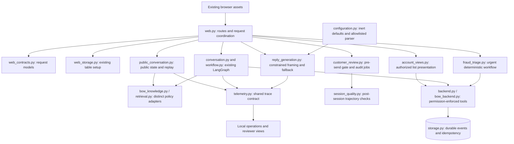

# Implemented Architecture

This is a module map for the behavior-preserving refactor, not a new product design. `main.py`, `resolveguard.web:create_app`, existing routes, request schemas, UI assets and CLI entry points remain compatible.

## HTTP and services

`web.py` keeps request validation, cookie/session handling, authentication continuation, safety interception, route registration, and coordination. Existing models are defined in `web_contracts.py` and re-exported through `web.py`; their historic module identity is retained. `web_storage.initialize_web_storage` executes the original SQL statements in the original order. It does not add a schema version or migrate customer data differently.

`public_conversation.public_bow_turn` owns the existing public context transaction, payload-bound replay guard, date/source-version checks, scoped retrieval spans, persisted output and review handover. The route-local wrapper preserves the original call signature. `account_views` lists only records returned by backend-authorized methods; the HTTP handlers retain existing pagination validation and identity binding.

## Graph and authority

The request graph still runs security assessment, classification, report capture, conditional record lookup, retrieval, handoff, composition and verification. The conversation graph keeps its existing checkpoint, draft/confirmation and ownership behavior. No node, edge, checkpointer namespace, model prompt, safety detector or policy has been redesigned. A model-generated decision cannot grant permissions.

The backend separates identity/assurance from resource/action authority. Durable report capture, legal-notice assessment, identity verification, case creation, investigation, support acknowledgement and simulated protection actions remain different states. Frontend state does not establish authorization. No transfer or refund capability is added.

## Retrieval contracts

| Dimension | BOW raw metadata | Legacy raw metadata | Preserved boundary |
| --- | --- | --- | --- |
| Bank/product | bank_id, product_id and product scope | product and jurisdiction | Existing BOW adapter exposes workflow-compatible policy evidence; never substitute another bank |
| Identity | chunk_id, doc_id | chunk_id, doc_id, version | Stable source IDs remain unchanged |
| Validity | effective_date, expires_on | effective_date, expires_at | Each adapter retains its existing date/version conflict semantics |
| Access/approval | PUBLIC and SYNTHETIC_APPROVED_FOR_TEST_ONLY | APPROVED_FOR_SYNTHETIC_TEST | Synthetic approval is not institutional approval; private records are not policy search content |

The adapters already serve the application contract while accepting different source schemas. They are deliberately not replaced by a schema migration in a refactor.

## Configuration and observability

`configuration.py` centralizes the existing provider/model defaults and simple literal environment parsing. It has no `.env` load or network side effect on import. Runtime reply loading and explicit evaluation loading retain different allowlists and file guards. Existing process values win; fixed endpoints, timeout rules, model settings and live-mode defaults remain unchanged. `NEBIUS_BASE_URL` is not newly activated.

`Trace` remains the common event/span contract. Cloud projection, reviewer masking and local telemetry intentionally have different privacy purposes. No trace labels, public output keys, fingerprint encoding, idempotency key or historical execution record is rewritten.

See [original audit](CODEBASE_AUDIT.md), [evaluation](EVALUATION.md), [security](SECURITY.md), [development](DEVELOPMENT.md) and [change log](REFACTOR_CHANGELOG.md).
