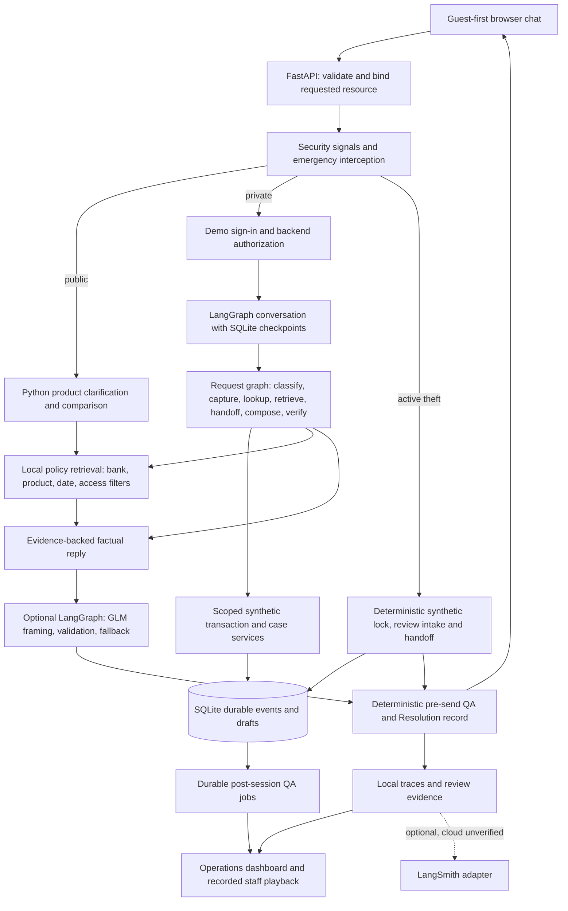

# Implemented architecture

Code evidence: `resolveguard/web.py`, `workflow.py`, `conversation.py`, `request_context.py`, `bow_knowledge.py`, `reply_generation.py`, `customer_review.py`, `session_quality.py`, `reviewer.py`, and `dashboard.py`. Public/emergency/review handlers are not all nodes in one graph. No independent free-running agent swarm, vector database, verified cloud deployment or real banking services are implied.
