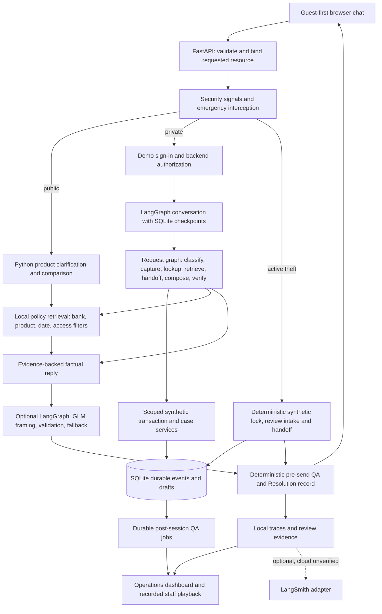

# ResolveGuard AI — Secure Banking Customer Support Assistant

Evidence-grounded banking help with guest-first access, scoped synthetic services and auditable outcomes.

## 1. Project title and status
**Synthetic learning/portfolio project — not production banking software.** Submission materials are prepared; independent reference approval, judge calibration, video and upload remain incomplete. See [readiness checklist](submission/SUBMISSION_CHECKLIST.md).

## 2. Project summary
ResolveGuard AI is a learning prototype for secure banking customer support. Customers often repeat their questions, struggle to understand fees or case progress, and face unnecessary sign-in steps when they only need public information. Banking support also has a more serious responsibility: it must preserve possible fraud reports without exposing another person's financial information or claiming that an action succeeded when it did not.

ResolveGuard combines a guest-first chat interface, product-specific policy retrieval, permission-checked synthetic account services, and controlled response validation. Public questions can be answered without sign-in. Personal requests use a separate demonstration authentication flow and backend authorization. Reports, support cases, human handoffs, and simulated protective actions have distinct evidence-backed states.

The project also demonstrates an evaluation lifecycle: versioned scenarios, baseline failure analysis, targeted rule improvements, regression tests, actual model-based grading, and local trace inspection. Its intended value is clearer answers and next steps with less repetition; no measured business savings are claimed. All banking records and offers are fictional. Independent reference approval, judge calibration, production controls, and external integrations remain incomplete.

## 3. Problem statement
Banking support combines repetitive questions, unclear case status, incorrect policy explanations, sign-in friction, complicated fraud/error reporting and unauthorized-disclosure risk. A helpful answer must also be permitted, supported by evidence and truthful about what was actually completed. Business savings and customer-resolution improvements have not been measured.

## 4. Product features
| Implemented feature | User value and boundary |
| --- | --- |
| Guest-first chat and product clarification | Public policies without sign-in; exact product before ambiguous terms |
| Authentication on demand and saved-request resume | Demo sign-in is separate from chat; backend authorization still required |
| Scoped account/case reads and typed-resource binding | No foreign data or stale own-payment substitution; delegation checked |
| Durable report intake and case drafts | Capture differs from legal receipt; cases need confirmation, commit and stable retries |
| Human handoff and Resolution records | Truthful local acknowledgement, ownership and simulated callback evidence |
| Urgent theft interception | Deterministic synthetic lock/intake with verification; no real banking action |
| Pre-send QA and durable post-session audits | Controlled facts and action states checked; not an independent semantic compliance certification |
| Constrained GLM framing and fallback | Optional wording choices; factual paragraphs and tools remain controlled |
| Local reviewer/dashboard and encrypted exports | Demo staff scopes, recorded playback and polling-based alerts |

Planned/unverified: independent human qualification, institution-approved identity/policies/legal retention, real-time alert delivery and broader live-model measurements. Cloud, Replit and real bank integrations are deferred. Voice, funds movement, refunds, credentials and dispute adjudication are outside the MVP.

## 5. System architecture

Public product conversation is a direct Python handler; account conversations use a SQLite-checkpointed LangGraph wrapper plus the request graph. Live framing uses a second generate/validate/fallback graph. Resolution and QA are deterministic services behind one assistant. Emergency and welcome bypass model generation. See [architecture](docs/architecture/IMPLEMENTED_ARCHITECTURE.md).

## 6. Technology stack
| Layer | Technology | Purpose | Implementation status |
| --- | --- | --- | --- |
| Runtime/contracts | Python3.12, uv, Pydantic2 | Local environment and typed boundaries | Implemented/tested; pyproject/uv.lock authoritative |
| UI/API | HTML/CSS/JavaScript, FastAPI/Uvicorn | Customer and staff views | Implemented locally |
| Orchestration | LangGraph1.2.19, SQLite checkpoints | Defined nodes and durable turn state | Implemented/tested |
| Banking storage | SQLite and synthetic FixtureBank adapters | Authorized reads and payload-bound idempotency | Implemented; one-process demo |
| Public retrieval | Local metadata filters and keyword ranking | Applicable BOW/legacy policy evidence | Implemented; no deployed vector database |
| Generation/evaluator | Nebius GLM-5.3-Flash | Constrained framing and separate grading | Adapter tested; saved actual evaluator results |
| Semantic evaluation | RAGAS0.4, Qwen3-Embedding-8B | Recall/precision/faithfulness/relevance | Actual saved12-case evaluation |
| Observability | Local spans, operations/reviewer, LangSmith SDK | Evidence inspection and prepared export | Local verified; LangSmith Cloud unverified |
| Export encryption | cryptography AES-GCM | Password-protected reviewer packages | Tested; not independent archive immutability |

## 7. Banking data and knowledge sources
Bank of Whatever contains11 products,19 policies,61 chunks,12 customers,12 accounts,48 transactions,12 sessions,12 cases,2 delegations,1 intake fixture and100 evaluation rows. All are fictional; APYs are invented demonstration values. Source validity is clock-dependent. No real customer data is needed or connected.

`data/bow/active.json` points to a hash-validated workbook snapshot. Chunks carry bank/product scope, source IDs, dates, access level and test-only approval. Public retrieval filters these before ranking and never borrows another bank's policy. Private records use backend permissions, not public RAG. Legacy chunking targets roughly400 whitespace tokens with50 overlap while preserving lists/tables/exceptions; BOW uses its imported61 chunks. Test approval does not equal institution policy approval.

## 8. Evaluation methodology
Golden scenarios → baseline → failure analysis → targeted improvement → regression → human review → optional judge calibration → trace inspection. Exact checks govern routing, permissions, amounts, committed states, preserved reports and tool paths. Semantic judgments supplement them. All applicable checks must pass; judge PASS requires each dimension>=4/5. Unrun or invalid outputs are never counted as passes.

The historical40-case set has20 happy,12 edge,6 anticipated-failure and2 adversarial scenarios, with3 repeats per version. Aliases in the final workbook are **V1=v0 baseline** and **V2=v4 improved**. Other suites are separate, overlapping sources, not additive independent customer samples. Five learning bars are retrospective: intent>=95%, journey>=95%, fraud recall100%, local mock p95<=100ms and provider API cost$0 for offline mock only.

## 9. Evaluation results
| Metric | Baseline | Improved | Dataset size | Execution type | Evidence |
| --- | --- | --- | --- | --- | --- |
| Intent accuracy | 85% | 100% | Same40;3 repeats/version | Historical mock rules | [comparison](artifacts/mock_iterations_final/comparison.json) |
| Journey pass | 80% | 97.5% | Same40;3 repeats/version | Historical mock rules | Same comparison |
| Fraud/error recall | 80% | 100% | Fraud subset of same40 | Historical mock rules | Same comparison |
| Local p95 | 30.950ms | 30.577ms | 120 executions/version | Historical mock timing | Same comparison |
| Provider API cost | $0 | $0 | 120 executions/version | No provider calls; excludes compute/hosting | Same comparison |
| Original100 local checks | Not a matched baseline | 100/100;84/84 critical | 100 | Current synthetic; versioned emergency contract | [summary](artifacts/remediation_20261101/original100_final/summary.json) |
| BOW100 local checks | Not a matched baseline | 100/100;100 trace-linked | 100 | Current synthetic;16 source conflicts pending | [summary](artifacts/remediation_20261101/bow100_release/summary.json) |
| Public semantic judge | No matched baseline | 12/12 PASS | 12 | Actual saved GLM evaluator calls | [results](artifacts/local_completion/semantic_expanded_final.json) |
| RAGAS faithfulness | No matched baseline | Mean0.9167 | 12 | Actual saved model evaluation | Same results; two0.5 flags retained |
| Human–judge agreement | Unavailable | Unavailable | 0 reviewed pairs | Human calibration pending | [status](artifacts/remediation_20261101/calibration_status.json) |

Main tests:321 run,320 passed,one skipped; fixtures13/13. These are saved executed results from the remediation, not new runs during packaging. No GLM improvement is inferred from mock gains; tokens are unavailable rather than zero. The small mock latency delta is not a meaningful speed claim. The current100-case suites are executed, not NOT_RUN, but qualification remains BLOCKED. See [evaluation report](submission/EVALUATION_REPORT.md) and [workbook](ResolveGuard_AI_Final_Evaluation_Submission.xlsx).

## 10. Failure analysis
| Example | Expected vs actual historical behavior | Cause/change | Regression evidence |
| --- | --- | --- | --- |
| RG-020 / RG-033 indirect fraud | Preserve report; baseline missed indirect signal | Added indirect unauthorized-use recognition | Fixed in historical v4 |
| RG-032 / RG-053 human request | Retain human flag/handoff; baseline missed phrases | Added human/fraud-support wording | Fixed in historical v4 |
| RG-018 / RG-050 case/retry | Create/reconcile intended case; baseline wrong route | Added ticket/duplicate-submit phrases | Fixed in historical v4 |
| RG-056 policy retrieval | Required privacy evidence; historical passage absent | Later retrieval correction, outside matched experiment | Historical v4 still FAIL; later current suite passes |
| Typed BOW-ACC-003 plus old selection | Deny requested foreign account; old own payment displayed | Explicit resource binding and backend mismatch checks | New targeted regression passes; human reassessment pending |

Eight unique historical baseline failures are assigned one primary category in the workbook. Engineering annotations are not falsely presented as independent human approvals. Raw failed assertion labels remain available. Exact customer input and outputs are in the workbook.

## 11. Observability
Local traces record actual step timing, parentage, evidence and outcomes. Current BOW cases have explicit result-to-trace links. Operations separates API/workflow/generation latency and errors; model tokens are stored when reported, live price remains unknown. Reviewer playback never repeats a banking action. Staff notes/exports are scoped and audited.

Alerts evaluate polling-based last-N rules, not verified real-time notification SLAs. LangSmith adapters and remote verification code exist, but hosted datasets/experiments/read-back remain unverified and intentionally deferred. Cloud projection omits content, so it does not by itself satisfy the Academy's content-rich hosted trace evidence. See [observability runbook](docs/OBSERVABILITY_RUNBOOK.md).

## 12. Safety and governance
Authentication proves identity; backend permission independently controls each resource/action. Chat claims of consent, family relationship or administrator status confer no authority. Reports are preserved before private lookup and keep capture, legal notice, verification, investigation and confirmation distinct. Forbidden financial tools are unavailable. Urgent locks and callback commitments are explicitly synthetic.

Masking, field allowlists and evidence checks limit exposure but do not establish universal PII detection or regulatory compliance. SQLite append-only controls are not privileged-tamper-proof archives. Retention, legal holds, signed service context and institution approvals remain open. PRD/BRD source documents are review drafts, not proven signed approvals.

## 13. Demo instructions
From the project root in PowerShell:
```powershell
uv sync --locked --extra evals
# Credential-free demo/tests; overrides any local live setting in this terminal.
$env:RESOLVEGUARD_REPLY_MODE='off'
$env:LANGSMITH_TRACING='false'
$env:RESOLVEGUARD_CLOUD_TRACING='false'
uv run --locked python main.py
```
Open http://127.0.0.1:8765. In another terminal run `uv run --locked python -m resolveguard dashboard --port 8766`; keep its generated/local access token private. Each independent project uses its own uv-managed .venv. No keys are needed for mock chat; optional provider settings belong in an untracked .env created from [.env.example](.env.example).

Try: “What is the current APY?” → choose a savings product; “Show my recent transactions” → demo sign-in; foreign account request → denial; guest unknown-charge report → preserved intake and safe follow-up; case creation → review/confirm before commit. Follow the [five-minute script](demo/demo_script.md). Do not enter real credentials.

Repeat current checks with provider generation off:
```powershell
uv run --locked --extra evals python -m unittest discover -s tests -q
uv run --locked --extra evals python -m unittest discover -s resolveguard_synthetic_v04/tests -q
uv run --locked --extra evals python -m resolveguard.full_evaluation --suite original --output artifacts/my-original-run
uv run --locked --extra evals python -m resolveguard.full_evaluation --suite bow --output artifacts/my-bow-run
```
Use fresh output paths. Paid semantic commands are deliberately separate; see the runbook. Historical scores are reproducible as saved evidence; exact historic code/fixture checkout is not recovered, so rerunning current code need not reproduce old timings/scores.

## 14. Limitations and future roadmap
See [known limitations](submission/KNOWN_LIMITATIONS.md). Priorities: approve references and exact human calibration labels; review two semantic disagreements; independently recheck UI/live behavior; finish video/upload; address retained alerting/governance gaps. Production integrations require separate authorization and institutional decisions.

## 15. Repository, demo and documentation links
- GitHub: **NOT_PUBLISHED — verified URL pending**; no remote repository is asserted.
- Public deployment: **NOT_DEPLOYED**. Local demo: http://127.0.0.1:8765.
- Video: **NOT_RECORDED**.
- [PRD v0.4](ResolveGuard_AI_Final_PRD_v0.4_Risk_Remediated.pdf) · [BRD](ResolveGuard_AI_BRD_Agent_Observability_v1.0.pdf).
- [Final workbook](ResolveGuard_AI_Final_Evaluation_Submission.xlsx) · [submission summary](submission/SUBMISSION_SUMMARY.md).
- [Current test results](artifacts/remediation_20261101/tests_final.log) · [architecture](docs/architecture/IMPLEMENTED_ARCHITECTURE.md).
- [Inventory](submission/SUBMISSION_INVENTORY.md) · [checklist](submission/SUBMISSION_CHECKLIST.md).
