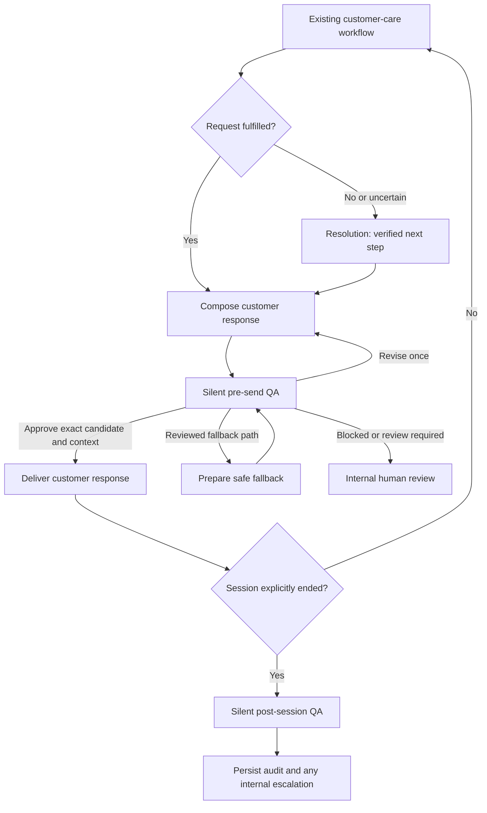

# Resolution and silent QA: contracts and transitions

Status: **active in local customer chat** through `customer_review.py` and the
shared response boundary in `web.py`. This activates deterministic evidence
checks and session audits; it does not introduce live model calls or cloud export.

## Activation behavior

Every chat reply, authentication-resumed reply and restored account conversation
passes the same gate after its customer text, cards and sources are assembled.
Public retrieval keeps its existing bank/product boundaries. Account cards are
re-read through the backend with current permissions and compared to their source
records. Claimed report, case and handoff receipts must match durable events,
their owner, bank and returned fields. Case bank ownership is established through
the account backend, since existing case events do not carry a bank field.

Resolution records supported next steps for report/case/handoff, authentication
and unresolved-request paths. A receipt leaves the issue **unresolved**. The local
`DemoOperations` service now persists priority assignments from verified receipts.
Callbacks remain unconfirmed unless a verified, currently authorized customer
explicitly requests a simulated callback; its versioned backend record identifies
the queue and window. These are invented local test commitments, not bank SLAs or
real calls. Resolution creates no duplicate cases, and case confirmation and
reconciliation remain in the customer-care workflow.

Pre-send QA uses the typed transition rules and binds approval to a fingerprint
of the complete candidate plus an access/evidence snapshot. A failed candidate
is retained as a structured finding, replaced with a neutral public fallback,
and that fallback is separately reviewed. If that review cannot be persisted or
approved, delivery fails closed. There is no model rewrite loop in this version.

The eight QA dimensions are **bounded deterministic invariants**, not an online
LLM judge or proof of semantic correctness. Grounding checks validate source
identity/currentness, not full natural-language entailment. Intent accuracy has
no independent online golden label, so `INTENT_ROUTING` is explicitly
`NOT_EVALUABLE`, not a fabricated pass. Pre-send safety approval is still possible
with that noncritical uncertainty; post-session review records `NEEDS_REVIEW`.
Existing offline semantic evaluations remain necessary. Independent local
post-session checks now also inspect delivered replies, receipt ownership,
report preservation and retry commitments. Noncritical unmeasured intent alone
does not require a human task; actual failures and incomplete critical evidence do.

## Session audit processing and local records

New conversation, demo sign-out/profile replacement, and authentication identity
transfer enqueue a durable end job **in the same SQLite transaction** as the
session change. An observed expired session also enqueues an end event. A local
worker checks every 30 seconds and closes inactive review sessions after 30
minutes. A network/request timeout alone is not a session end. Audit work is
separate from sending customer replies; failed jobs remain retryable and restart
recovery runs when the app starts. No customer-facing QA messages or external
Slack/Teams notifications are sent.

The application database (default `artifacts/web.sqlite3`) contains:

- `customer_reviews`: append-only application inserts with typed PRE_SEND QA,
  Resolution outcome, source references, fingerprints and review duration.
- `review_sessions`: local session generations, including public-only chat.
- `session_audit_jobs`: durable job state, attempts, sanitized error class and
  typed POST_SESSION reports; critical findings escalate internally.

Review records contain no chat text, raw account payload, credentials or system
prompts. Backend receipts and source IDs remain local. Existing intake storage
continues to preserve original customer reports under its existing controls.
SQLite files require local filesystem protection; these records are not a
tamper-proof regulatory archive or a completed admin dashboard.

Retry pending/failed jobs manually with no network calls:

```powershell
uv run --locked --extra evals python -m resolveguard.customer_review --database artifacts/web.sqlite3
```

Local reviewer UI, synthetic priority/callback records and explicit late-event
audit revisions are implemented. A request keeps its original conversation
generation across reset; changed evidence appends an immutable application report
revision. Old revisions remain available. Human semantic review and real-service
commitments remain separate. The worker never repeats banking actions.

## Agreed customer experience

Customers continue speaking to one ResolveGuard assistant. Resolution handles
unresolved work. QA never speaks directly to customers: a pre-send gate checks
each candidate reply, and a separate post-session reviewer creates an internal
audit after the session ends. Neither reviewer may change banking records.

The diagram is the agreed target flow. The active implementation uses a single
fixed fallback, without model rewrites or a human-review UI. Its session audit
aggregates recorded checks rather than independently assessing the full dialogue.
See the [alignment review](IMPLEMENTATION_ALIGNMENT_REVIEW.md) for verified gaps,
including the difference between validating sources and validating answer claims.



## Contracts implemented

| Contract | Purpose and constraint |
| --- | --- |
| `EvidenceRef` | Versioned policy, runtime, trace or review reference. Backend events also identify their event type and resource. |
| `PriorityProposal` | Advisory P1–P4 suggestion with evidence; it cannot become an assigned priority by relabeling its fields. |
| `PriorityDecision` | Backend queue assignment with rule/version and a matching assignment event. No callback time is derived from the tier. |
| `CallbackCommitment` | Either unconfirmed with no promised window, or confirmed with aware timestamps and a matching callback event. |
| `ResolutionInput` | Privacy-filtered summary, bank, session/turn references, intent, issue state, triggers and permitted evidence. |
| `ResolutionOutcome` | Separate issue state and next-step state. A saved case/handoff must reference matching backend events. A handoff receipt alone cannot mark the issue resolved. |
| `QACheck` | PASS, FAIL or NOT_EVALUABLE, severity, method, reason and evidence. Critical checks cannot be downgraded or passed solely by model opinion. |
| `QAReport` | Distinct pre-send/post-session decisions, consistent risk and human-review requirements. Every dimension appears exactly once. |
| `ReviewCheckpoint` | Bank/session/turn-scoped transition input, candidate/context fingerprints, rewrite budget and session-end state. |

These are strict, frozen Pydantic models with immutable evidence/check tuples.
Extra fields, malformed IDs, string booleans and naive callback timestamps are
rejected. The contracts contain no financial-action command or customer-message
delivery tool. Callback/priority examples are structural demonstrations, not actual
institution-approved rules or service commitments.

**Schema validation is not authority.** A caller can type a nonexistent event ID
into valid JSON. The upcoming backend integration must independently resolve the
reference, verify bank/resource/principal scope, check current state, and construct
verified outcomes. Privacy filtering also remains a service responsibility; a
string called `summary` is not automatically free of personal information.

## QA rules

Required checks: intent routing, error-report preservation, authorization, tool
correctness, grounding, action integrity, privacy and customer experience.

- Authorization, error preservation, tool correctness, grounding, action integrity
  and privacy are critical dimensions. They cannot be averaged with friendliness.
- A critical FAIL produces CRITICAL risk, requires human review, and blocks the
  original draft or sends it to a separately reviewed fallback path. A post-session
  critical failure requires internal escalation.
- Missing critical evidence produces HIGH risk and cannot approve delivery.
- A valid low-risk public reply does not require an invented intent label. An
  unavailable human-approved label is explicitly NOT_EVALUABLE; it may coexist with
  delivery approval when all safety checks pass, but the report remains MEDIUM risk
  rather than claiming complete quality verification.
- A pre-send report identifies the exact candidate response and context snapshot.
  A changed draft, access snapshot, turn, session or bank invalidates that approval.
- Post-session reports record, flag or escalate. They cannot approve a past reply
  or silently rewrite an existing conversation or backend action.

## Transition map implemented as a pure selector

`next_review_stage()` performs no side effects. It validates a checkpoint and
returns the next planned stage. It is not a new running LangGraph agent.

| Current stage | Condition | Next stage |
| --- | --- | --- |
| Assess issue | Fulfilled | Draft response |
| Assess issue | Unresolved/unknown | Resolution |
| Resolution | Outcome or explicit uncertainty recorded in correct bank | Draft response |
| Draft/fallback | Candidate fingerprint and context captured | Pre-send QA |
| Pre-send QA | Bound approval | Deliver |
| Pre-send QA | Revision requested; budget unused | Draft response |
| Pre-send QA | Safe fallback requested; budget unused | Fallback draft, then QA again |
| Pre-send QA | Blocked, review required, or budget exhausted | Human review |
| Deliver | Valid bound approval and session remains open | Session open |
| Deliver/open | Explicit session-end event | Post-session QA |
| Post-session QA | Matching audit report after session end | Audit recorded |

An orchestrator using model rewrites must increment rewrite/fallback counters atomically and
clear stale approvals whenever it creates another draft. The current boundary permits
one separately reviewed fixed fallback and does not enable model rewrites. Merely obtaining a
`DELIVER_RESPONSE` stage does not send a message. The delivery service must check
current permissions and authoritative state again.

## Original integration checklist (implemented locally as described above)

1. Build a shared response boundary covering every early return in `web.py`, public
   comparisons, protected LangGraph journeys, authentication resumption and retries.
2. Assess the outcome from verified events. Activate Resolution only when needed.
   Preserve error intake before authentication and existing case-confirmation rules.
3. Render the complete proposed customer payload through presentation code, then
   fingerprint **text, cards, sources and action controls**, together with the bank,
   policy/backend versions and authorization snapshot. Reviewing text alone would
   miss a confidential card or unsupported action button.
4. Run deterministic safety checks first; use model critique as advisory or combined
   evidence. If a draft changes, create a new fingerprint and review it again.
5. Persist approved delivery separately from unapproved internal drafts. Replayed
   requests still require current context/permission checks.
6. Before resetting a conversation, capture an idempotent session-end event and
   enqueue post-session QA with the retained, privacy-filtered evidence references.

Session end and banking resolution are separate facts. A conversation can finish
while a case remains open. A browser/network timeout is not a session-end event:
the backend may still complete a request and the customer may retry its existing
key. Handoff alone ends the bot session only when a trusted ownership-transfer
event explicitly closes that session/segment. Idle expiry needs a configured rule;
the activation now uses an explicit 30-minute local inactivity rule. No callback promise is invented.

## Extensions beyond the active deterministic demo

- Authoritative priority rules, queue registry and confirmed callback/SLA source.
- Independent semantic assessment and human review of unknown intent labels.
- Model-assisted rewrites, if separately enabled and tested.
- Explicit audit revisions for late results from externally asynchronous services.
- Internal dashboard views and approved notification delivery.
- Production identity, consent and retention controls plus institution approval.
  Local activation is not production or compliance approval.
